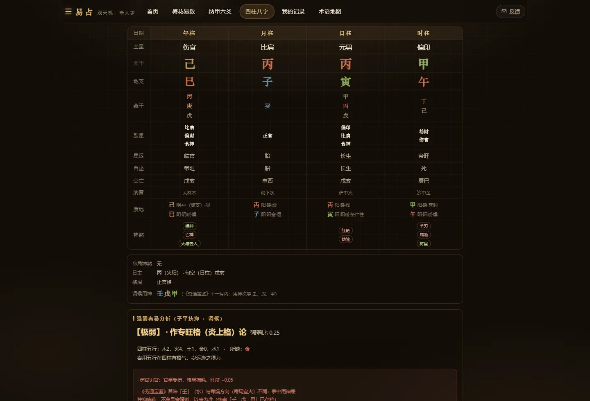
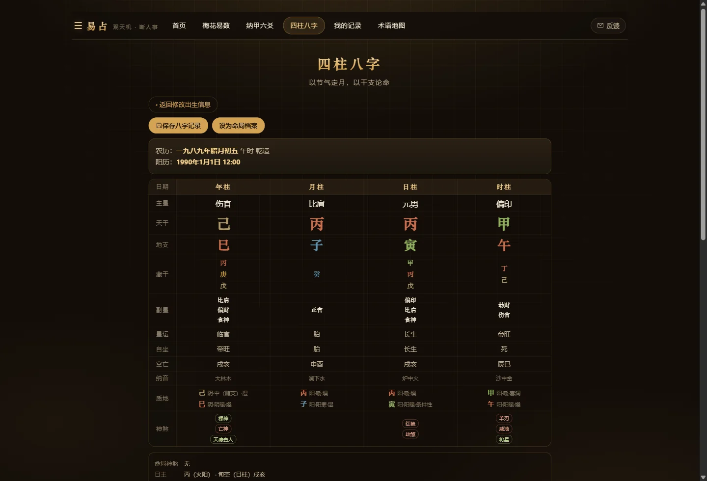
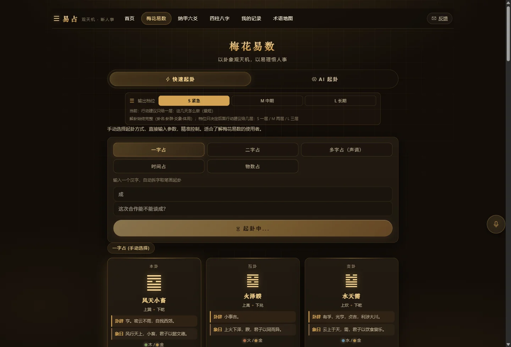
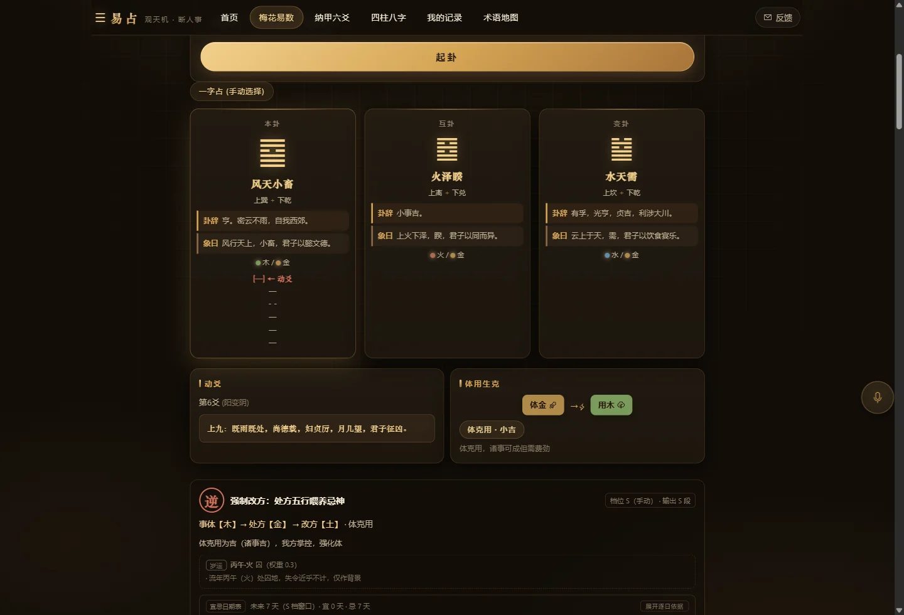
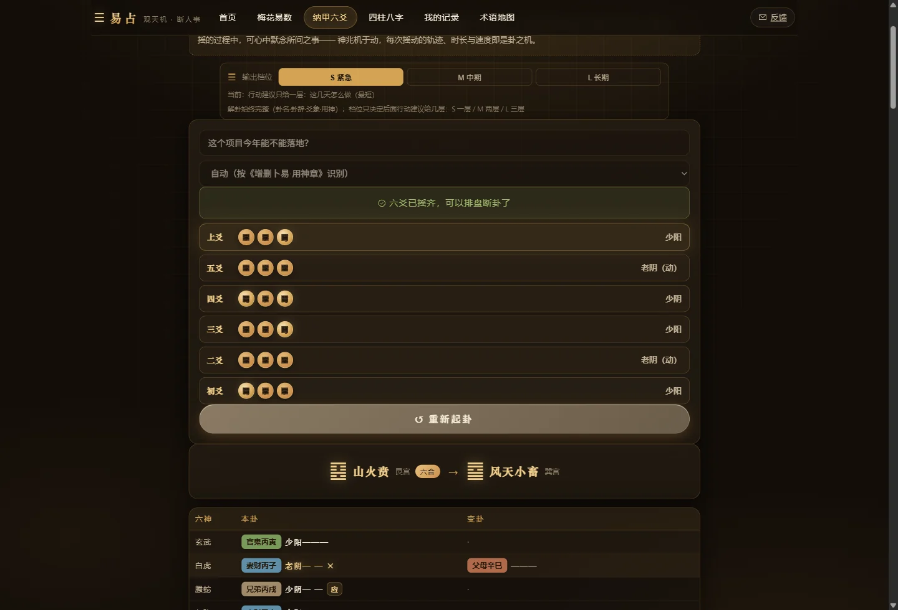
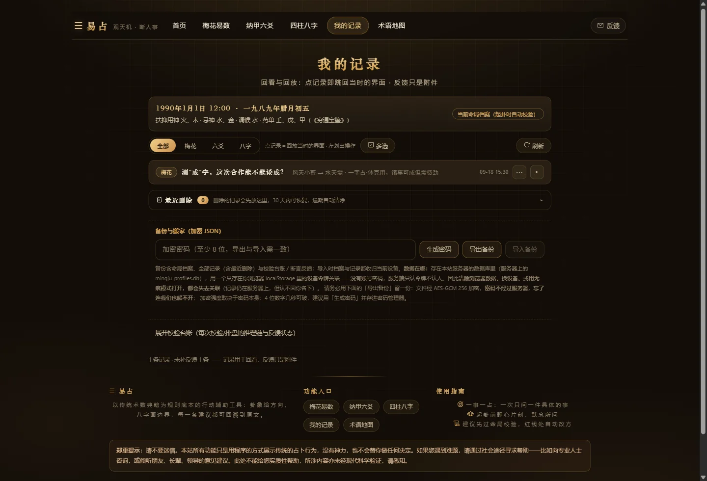
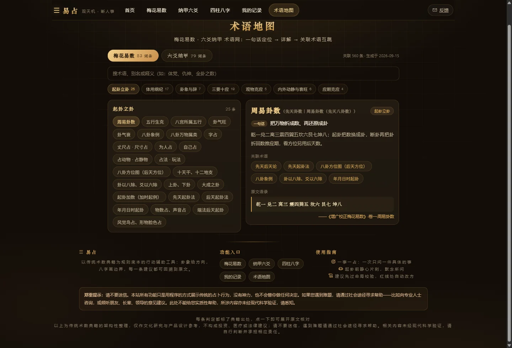

# 八卦站 · 产品流程总图

**给术数同行看的一版**（试用与评审用）

---

## 〇、这份文档怎么读

**我们做的是什么。** 不是"AI 算命"。吉凶、用神、改运方向、应期，全部由程序按典籍规则算出；AI 只负责把算出的结果**说成人话**。这是第一原则，后面每一处设计都是它的推论。

**怎么排。** 按你实际会用的五个板块讲：**八字 → 梅花 → 六爻 → 记录 → 术语**。每块三件事：它管什么、页面长什么样（**八张真实截图**）、流程怎么走（文字，不画图）。第六节把五块串起来。

**四个标记。**

| 标记 | 含义 |
|---|---|
| 📜 | **典籍直接原文**——书上写明了 |
| 🔢 | **典籍给了次序／结构，数值是我们定的**——顺序有据，数字未经案例校准 |
| 🧩 | **由书理类比外推**——书证说的不是这件事，我们外推过来，并明确标注 |
| ✅／🔶／⏳ | 已定案／待校准（数值先定，等反馈改）／尚未完成（已登记未做） |

**三句立场。** 一，凡书上没有的，我们不编：原文没直断的地方，页面就写"须详理"。二，我们自己定的数值全部标注，并写明"未经案例校准"（第九节乙逐条列出）。三，校准只做边界监控，不做拟合——术数没有对照组，拟合即自欺。

**想逐条挑判据的，直接翻附录 C（判据总表）。** 六爻·梅花·八字三条线，每条判据列了五样：判据是什么、依据哪本书哪一篇、用什么书例验过、代码写在哪、测试盯在哪。两书有异的地方（比如"日破"甲立乙不立）单独列了一节，说明本站取哪一说、为什么。

> 截图取自本机运行的真实页面，用的是一份**虚拟命局**（1990 年 1 月 1 日 12:00，男）与示例问句，不含任何人的隐私数据。

---

## 一、八字：先立边界，再谈卦

这一板**不占卜**。它只算一件事：这个人的命局底线在哪——**喜用**（该扶什么）、**忌神**（不能碰什么）、**调候**（眼下最急什么）。之后每一次起卦，都要拿这三张清单来比对。

所以八字是另外两条线的地基：**先把边界立住，卦才有得比。**

**流程**

1. **填生辰**：公历／农历、年月日时、性别、出生地区。
2. **校时**：按出生地经度换算**真太阳时**（含均时差），另设夏令时开关。
3. **排盘**：**以节气定月**（立春起寅月，不看农历初一）；出四柱干支、藏干（人元）、十神、纳音、神煞、大运顺逆与流年。
4. **挂质地三标签**：每个干支标 阴阳·寒暖·燥湿。
5. **算强弱**：得令（月令）50% ＋ 得地（通根）30% ＋ 得势（党众）20%。
6. **查格局**：从格化格四查——化气、从儿、专旺、从弱，分真／假。
7. **取用**：扶抑定喜用与忌神；调候取《穷通宝鉴》**该月该干用神次序的首味**，出处直接标在页面上。
8. **设为命局档案**：一次入库，终身不变。此后每次校验只读它，不随卦改动。

**这一板值得看的四处**

- **纳音存先天，后天为用**。纳音（连同命宫、胎元、身宫）出自河图生成数，页面同列展示，但**不参与任何判定**——取用、旺衰、调候全部走干支正五行。类物建议里的"数字"用河图生成数同理：**取象可存先天，为用必取后天**。
- **质地按"载体"分列，不跨载体互推**。土分湿燥（丑辰湿土、未戌燥土）有书证；**申酉标"歧异"**——方位层说"西北为湿"，《滴天髓》原注说"金燥而宜湿"，两条并列不择一；**寅卯标"条件性"**——缺逐支条文，随局中水火定。我们宁可让页面显示"这处有分歧"，也不合成一个假的确定值。
- **调候照表取首味**，页面写明"《穷通宝鉴》十一月丙，用神次序壬、戊、甲"。取首味而非全表，是为把"当下最急"这一味单独拎出来；其余二味仍随原文列出，供你比对。
- **一条自设规则**：书上给了扶抑与调候两条取用路线，**没说冲突时谁优先**。我们定"从格成格则调候让位"（依"格局不可逆"之义）。这条最可能被同行驳，写在第九节甲·4，欢迎当面驳。

---

## 二、梅花：一事一占，看它怎么变

梅花主**变**。起卦快，看的正是这一件事的走向，所以它回答的不是"运气好不好"，而是"**这件事现在该怎么办**"。

**流程**

1. **起卦（端法五种）**：一字占（拆字取笔画）／二字占／多字占（按声调）／时间占（年月日时加时取爻）／物数占。另有 **AI 起卦**：用大白话描述，程序把参数抽出来；配语音输入（长按约 0.6 秒），免得打字错过那一下。
2. **定动爻**：**卦以八除、爻以六除**（除尽作八、作六）——先天卦数取上下卦，总数除六取余定动爻。**先天数管"数"与"期"，一旦断方位，一律取后天**：五行方位出《五行大义》，八卦方位取乾西北、兑西、离南、震东、巽东南、坎北、艮东北、坤西南——全库无一处用先天卦位（乾南坤北）取象。术语地图有专词条，原文即"端法后天起卦、占卜坐端之诀皆以后天方位为准"。
3. **分体用**：**动爻所在之卦为用，静者为体**。这一步机械确定，**与问什么事无关**——这正是我们选梅花体用的理由：不给"按问题挑答案"留任何空间。
4. **排互卦、变卦**：互卦主中间之应，变卦主末后之应。
5. **断体用五态**：比和／用生体／体生用／体克用／用克体，各配断语（如"用克体，诸事不利，宜守不宜攻"）。
6. **看卦气旺衰**：体卦宜旺、生体之气宜旺、克体之气宜衰（《心易衰旺诀》）。
7. **出处方五行 R**——**按五态分支，不是一律补身**（见下表）。
8. **命卦校验**：R 拿到命局三张清单上过三道门（第六节细讲），可能被判红并**强制改方**。
9. **流动五行判定表**：把"补这个五行"拆成四条管道——进气（生我·印）／出水（我生·食伤）／我克（财）／克我（官杀），逐条给理由与出处。
10. **应期与择日**：应期按先天卦数定速缓——成卦总数**折半为速、倍之为缓**（"行则应速，坐则应迟"，据占者动静取）；可成之日取**生体或处方当值且旺相**之日，避险之日取**克体当值且旺相**之日；择日逐日给宜忌与理由。
11. **AI 成文**：第一部分·解卦 ＋ 第二部分·行动建议。
12. **存记录**：起卦参数、判定链、建议全部落库，可回放。

**处方 R 的分支（这一板的核心）**

| 体用五态 | 处方 R 取什么 | 依据 |
|---|---|---|
| 用克体（凶） | **克用者**——制用通关 | 《体用总诀》 |
| 变卦克体 | **克变者**——防末后之凶；若同时用克体，另备一枚改方 R_alt | "变卦克体，事于末后必有不吉" |
| 体卦失令（休囚死） | **生体者**——扶体 | 《衰旺诀》"体衰而有生体之卦则衰稍解" |
| 体生用（泄） | **生体者**——帮扶体 | 同诀（"有耗失之患"） |
| 用生体（吉） | **取用**——顺其生势，维持用生体 | 《体用总诀》 |
| 体克用（吉）／比和 | **取体**——我方掌控，强化体 | 同上 |

六条分支，每条都有出处，没有一条凭手感。**互卦生体**另加一句"中间渐有转机"，**变卦生体**加"末后有救"——这些是断语，不改判定。

**关于 S／M／L 三档**（工程分层，非典籍所有）

**解卦部分三档一样完整**（卦名·卦辞·爻象·体用），档位只管行动建议给几层：**S** 一层——方位、颜色、数字、随身物件（约 300 字）；**M** 两层——加行业职能、屋宅与办公布局（约 700 字）；**L** 三层——再加饮食五味、作息起居与四时调养、健康倾向（约 1200 字）。越档不写。

**还有一处原则**：你问什么事，程序只用来**决定断语往哪个方向说**（工作／财运／感情），**不参与任何判定**。同一个卦，问事业与问疾病，吉凶结论一样。

外应（起卦时眼前发生的动静）另有一条链：配卦 → 与体卦论生克 → 调强弱迟速 → 多应取"先见者"为主 → 内外合断。三条硬规矩：**不改卦**（绝不重起、不动体用互变）、**不代拟**（原文没直断的组合标"须详理"）、**不猜**（配不到卦就请你换个说法）。

---

## 三、六爻：装卦、定用神、月日双裁判

六爻主**断**。三枚铜钱摇六次，纳甲装卦，先定**用神**（这件事在卦里对应哪一爻），再听月建、日辰两重裁判——它回答"这件事成不成、卡在哪一爻"。

起卦用的是**摇杆**：按住、朝任意方向拉满、松手，即为一摇；六摇自初爻（最下）至上爻（最上）。摇动的**轨迹、时长与速度**参与成卦的种子，每一卦都能原样复现回放。

**流程**

1. **摇卦六次**：逐爻记录，三枚铜钱的老阳／老阴／少阳／少阴按 1/8、3/8、3/8、1/8 的概率分布（这条实测校正过，见附录 B）。
2. **定卦宫与世应**：按**八宫卦序**反查——首卦世在上爻、游魂世四、归魂世三，**应隔世两位**。
3. **纳甲装卦**：浑天甲子逐爻纳干支；六亲**以卦宫五行为"我"**（生我父母、我生子孙、我克妻财、克我官鬼、比和兄弟）；六神按日干起、自初爻循环；另起卦身。
4. **标注空破动变**：旬空（六甲旬）、月破（月建冲爻）、暗动（日辰冲静爻）；阳动变阴、阴动变阳，**变爻纳甲取变卦，六亲仍照本宫**。
5. **定用神（两档流程）**：问句精确命中六亲 → 高置信直断，结果页给出判定依据，事后可改判；命中含糊或有多个候选 → **起卦前先请你二选**。例如"合作"一词天然横跨**兄弟**（合伙之人）与**妻财**（生意钱财）；而"问人先问人"——"父亲的病情"取父母爻，不因"病"字被降级。
6. **择用神爻**：用神两现三现时，按 **临月建 > 动爻 > 不空不破（旺相） > 先见** 取一（古法"两现取旺"，野鹤验例择临月建者）。**用神不上卦则查伏神**：回本宫首卦同爻位取回，与本卦同位之爻构成一对飞伏，再按飞伏关系判可用与否——**飞来生伏得长生**可用、**飞来克伏反伤身**不可用、**伏去生飞泄气**不可用、**伏克飞为出暴**可用、飞伏比和可用；另两条例外：**飞神空破则压制失效**、**日月临伏神之支则引拔而出**。
7. **排元忌仇与月日双裁判**：生用神者**元神**、克用神者**忌神**、生忌神者**仇神**；月建定旺相休囚，日辰管生克冲合；**贪生忘克**——中间五行把攻击改道成输送（通关在六爻侧的原生形态）。
8. **出处方五行 R**（按三档分支，不是一律通关）：忌神发动有力克用神 → 取**克忌者**制忌；用神衰弱 → 元神有力则取**元神**生扶用神，元神无力则取**生元神者**以救元神；用神不弱 → 直接加持**用神本气**。改用神可**原地重算**，不必重摇。
9. **命卦校验 → 应期 → AI 成文 → 存记录**：应期按"静者逢值逢冲，动者合逢值"，给值日／逢合／逢冲／冲空／实破五类日子（30 日窗口）。

**这一板值得看的三处**

- **用神来自封闭枚举**（《增删卜易·用神章》：自占取世爻，问他人之事按六亲取用），不是模型"理解"出来的。歧义时宁可停下来问，也不猜。
- **同一个概念在两套体系里地位不同**：旬空在六爻是核心机制（填实、冲空、真空假空都参与判定），在八字语境里缺触发机制，因此**只展示、不进裁决**。这条边界是有意画的。
- **装卦可验**：乾为天、水火既济两卦的纳甲、世应、六神与《卜筮正宗》装卦定例逐项相符；三条《增删卜易》书例（巽之涣、观之否、乾为天）已固化成回归测试。

---

## 四、记录：留痕、回放、台账、导出

问完事，东西得在。这一板管四件事：**回看当时怎么问、怎么算、怎么答；回放界面；逐条验证；把数据带走。**

**四层数据，别混**

| 层 | 是什么 | 关键约定 |
|---|---|---|
| 命局档案 | 出生信息算出的基线（喜用／忌神／调候） | **一次入库终身不变**，每次校验只读它 |
| 记录快照 | 这一问的完整现场 | 可**完整回放**：点记录即跳回当时的界面 |
| 决策台账 | 每次校验一条**完整推理链** | 记下裁决档位、命中位置、大忌、**规则版本与阈值版本** |
| 断言清单 | 把一次校验拆成若干条**可判定的断言** | 每条注明"凭什么判、什么时候能判" |

**事后这一段怎么走**

1. 问事 → 自动落库（快照 ＋ 台账  断言清单）。
2. 到期回来，**逐条标记**：应验／未验／反向／无法判定／未观察。
3. 只有**擦着阈值翻转**的样本（判据值离阈值 ≤0.3）进边界台账——这是唯一能改数值的样本来源。
4. 样本够护栏（≥5 例、同向 ≥4 例）才生成"**待批**"提案；**人工批准**后才改阈值并升版本。绝不自动改数。
5. 删除是软的：**30 天内可从"最近删除"恢复**；导出／导入可搬家。

**三个设计理由**：整案级的"准不准"改不了任何数值，所以拆成断言级——否则收到的只是情绪，不是证据；远离阈值的案例只说明方向对不对，**改不动阈值**；档案是基线、记录是快照，**档案改了，历史记录仍按当时的基线回放**，否则事后归因全是错的。

**归属与承载**（同行问得最多的两条）：不注册、不收手机号，一枚随机设备令牌就是"账户"；代价是清缓存或换设备会失去关联，所以配了导出搬家，以及给单条断言签发**回执码**——不带令牌也能作答，还能生成日历提醒，等到应验那天。**备份只搬数据、不搬凭证**，导出文件里不含那枚仍有效的令牌。承载上：单 IP 50 次／日、全站软阈 80 次告警、硬阈 100 次——**只关 AI 解读，不关站**，判定与建议照常可用。而且**起卦与排盘不占额度**：卦象、体用、处方五行、应期全是确定性计算，一分钱不花，所以"起一卦看看"永远不被拦，只有"让 AI 讲一段"才计数（见第八章第 4 条）。

---

## 五、术语：162 个词条，每条附一句原文

这一板是把术语做成**能查、能核对**的工具：**一句话定位 → 白话详解 → 关联术语互跳 → 原文语录**。同行不必猜我们怎么理解"体用""三要十应"，点开就能看到我们引的是哪句、出自哪卷。

- 词条 **199 条**（页面可见 **162 条**：梅花 83／六爻 79），体系内关联 **560 条**，**悬空关联 0**。
- 每条一句**原文语录**，可逐字核对：**162 条，逐字命中 162，无原文 0，未命中 0**。这条防线由自动测试守着——引文改错一个字，测试就红。它已经抓出过我们自己的错：写「日应」引文时把底本的"寅卯未"当刊误改成"寅卯木"，却仍标"原文照录"，测试当场判不过，已改回底本原字。
- **绝不代拟**：底本确有刊误处（器物归卦"水之气属震、巽"，震巽属木，平行序列缺"木"）**照录原文**，另注义理取木。不改书，也不装作书上没这句。

---

## 六、五块怎么串起来

一句话：**八字给边界，卦给处方，处方过三道门，门后才有建议；建议落进记录，记录等来验证，验证喂回数值。**

**一次问事，从打开页面到收尾**

1. 选命局档案（没有就先在八字板存一份）。
2. 说所问（可语音），选档位 S／M／L。
3. 起卦或摇卦（梅花端法／六爻摇杆六次）。
4. 程序算卦侧：定体用或用神 → 出处方五行 **R**。
5. 程序读命局基线，跑**三道门**，给**红／黄／绿**：
   - **门1 忌神**：R 落在忌神上、或 R 生忌神 → **红牌拦截，强制改方**（按喜用重开处方）；
   - **门2 调候转急**：命局过寒或过燥且当令月令已激活——R 逆调候判红，R 同调候则加成升格；
   - **门3 喜用**：R 克喜用 → 红黄（方向可用但伤喜用）；R 生喜用或同五行 → 绿；其余为黄。

   门的先后就是优先级。改方由程序按喜用自动重开，**不是让 AI 另编一套建议**。
6. 叠加岁运：流年先被当月月令称重（旺相休囚死），再按从格行运表判吉凶——**只升降一档，绝不放行、绝不改方**。
7. 叠加流动五行：四条管道逐条给理由与出处（含乘侮、月令五态、地支作用、阴阳细分、质地分档）。
8. 出应期与择日：日期全部来自计算。
9. AI 成文：只写"解卦"与"行动建议"两部分，**不得与判定结论冲突**。
10. 落库：记录快照 ＋ 决策台账 ＋ 断言清单。
11. 到期逐条标记；擦阈样本进边界台账。
12. 够护栏 → 待批提案 → **人工批准** → 阈值升版 → 下一次判定起生效（历史记录仍按旧版回放）。

**为什么这样分层**：**确定性归代码，语言归 AI，校准归人。** 三件事各归一处，谁都不越界。

---

## 七、关键节点：改得最多、议得最久的那些

下面这张表是这份文档最该细看的部分。**"—"表示尚未发生**；修订轮次用方块表示（每块约一轮实质返工）。

**本节起每条都带一个"类"**，全文同一个标准，先说清免得各人各解：

- **学术类**——条文、书证、判据、术数义理。管的是"**书上怎么说；书上没说时，我们凭什么这么定**"。
- **技术类**——架构、精度、隐私、性能、测试、部署。管的是"**怎么把它做成能跑、能查、能改的东西**"。

分类之后**同节内按类重排**（学术在前）：一条一条读下来时，先看完"我们怎么讲理"，再看"我们怎么把它做出来"。**方块数照旧保留**——顺序变了，改动量还是看得见的。

| 类 | 编号 | 节点 | 改了多少 | 为什么反复 | 现状 |
|---|---|---|---|---|---|
| 学术 | **R5** | 乘侮徽标与静态格冲突 | █████ 五轮 | 同一格出现两套结论，谁说了算？最后**不新设优先级体系**，把乘侮定义为"静态格的量级调制器"；随后又发现告警判据把"同向确认"误报成"冲突" | ✅ 已处置（含逐条回源的反生反克豁免集） |
| 学术 | **R6** | 地支作用／干合的外推条目 | █████ 五轮 | 用断言语气说了类比外推的话——书证的主语是"命局内部"，我们却推到了"补益行为"上 | ✅ 已处置（句降级／条目标注出身／句式固化） |
| 学术 | **R7** | 燥湿标签 | ████ 四轮 | 原以为"平"档是自己造的中性档，重读原注后发现底本另有说法；最后改三态（湿／燥／歧异／条件性）＋来源强度，"平"退场 | ✅ 已核实收口（申酉分列不择一） |
| 学术 | **R13** | 外应参断 | ███ 三轮 | 第一轮只做了"回源核验"没实现，被用户当场指出欠账；第二轮查出底本版本异文；实现后实测又抓出一处逻辑错 | ✅ 已落地（三条硬规矩：不改卦／不代拟／不猜） |
| 学术 | **R11** | 生边单一（克边已三值化） | ██ 两轮 | 克边已三值化（乘／侮／正克），生边仍是二值；《元理赋》"金赖土生，土多金埋"一组母多灭子、子旺侮母的成句都有，是我们自己漏了一条边 | ✅ **已落地**（`sheng_triple`：正生／母多灭子／子旺侮母，与克边**同构**、共用同一势均带与月令加成） |
| 技术 | **R12** | 数据归属与隐私 | ██████████ 十余轮 | 公测级的数据归属问题，经两轮自查加一轮独立对抗性复核逐步收口 | ✅ 已处置（设备令牌隔离＋端点级回归＋独立复核 5 类问题全修） |
| 技术 | **R1** | 建议颗粒度 | ████ 四轮 | 产品原点就是"五行物品的建议"，而两批精度工程全落在判定与展示——建议层一度还是粗颗粒 | ✅ 已修（质地分档：两味分列、本味推荐、约束；丙·4 再降到**味级器物**） |
| 技术 | **R3** | AI 与判定层的一致性 | ███ 三轮 | AI 提示词不知道流动表／乘侮／五态，可能自说一套 | ✅ 已修（裁决档位与大忌清单注入提示词＋"不得冲突"约束），**并由丙·2 的回检程序兜底** |
| 技术 | **R4** | 流动表阈值硬编码 | ███ 三轮 | 阈值散在代码里，不能版本化，也无法做敏感度分析 | ✅ 已修（阈值入池，台账记阈值版本） |
| 技术 | **R2** | 卦侧精度与命局侧不对等 | ███ 三轮 | 命局侧已到干支级（质地／合冲），卦侧一度只有五行档 | ✅ 已修（藏干加权力量、天干五合、用神爻干支入链） |
| 技术 | **R14** | 语音输入（长按说话） | ███ 三轮 | 长按时长实机手感调整（1 秒改约 0.6 秒）；又修两个真 bug：按钮被容器推出屏幕、"中途插话"被自己的守卫挡掉 | ✅ 已落地 |
| 技术 | **R15** | 语音识别改用服务端 | ██ 两轮 | 第一版用浏览器自带识别，国内 Chrome 上直接不可用；第二版又接错了接口（打成了非流式端点），由实测校正 | ✅ 已落地 |
| 技术 | **R8** | 反馈闭环能否改数值 | ██ 两轮 | 原先反馈是整案级二值，无归因、无局部性，改不了任何数值 | ✅ 地基已建（三层结构齐备），**等样本** |
| 技术 | **R10** | 岁运层是否启用 | — | 曾被记为"留而不启"，是过时结论 | ✅ 已澄清：岁运层早已启用并有 20 条测试 |

**最深的三个点**（也是同行最该看的）：

1. **R12 这一路**（技术）：隐私问题不是一次修完的，是连着发现五类洞、每一类都由真实攻击路径复现后修掉的。最后一条规则定为"**客户端的 id 是数据，不是凭证**"——这句话是这类漏洞的通用病因。
2. **R5·边界**（学术）：告警判据初版只看"忌"这个字，不看"忌"的**理由**。而"忌"有两种来源、语义正好相反：忌"克不动"（克了白干，与"侮"其实是同一个判断）与忌"逆势"（格局不可逆，克有效且有害）。逐条回源后列出 17 个属于《元理赋》"反生反克"组的格位，压缩掉 15 条误报，保留 6 条真冲突——**并且不静默**：压制时写明"为何这次不告警"。
3. **R7 与版本异文**（学术）：碰到**多种说法并存**时，我们的做法是**分列两说、各标出处、不替人择一**。这里有两种情形，别混为一谈：一是**互相歧异**（申酉燥湿——方位层说"湿"、《滴天髓》原注说"燥"，两条确实相反）；二是**各说一层**（旺极见水——《滴天髓》说机理"抑之反激而有害"、《穷通宝鉴》说条件与后果"成方成局……见水激之则破格"，**两书其实都说"反激"、并不相反**，只是一个讲机理、一个讲何时破格）。这是我们处理一切"书上不止一种说法"的总办法。丙·3 把这个办法**做进了界面**：燥湿的"歧异／条件性"逐载体分列，一个载体一行、各挂出处，不再压成一句「歧异（燥｜湿）」。

---

## 八、产品深度：我们与"AI 算命"的分别

六条，按重要性排。每条带**类**（学术／技术，定义见第七章开头）。

### 1.（学术）确定性归代码，语言归 AI

吉凶不由模型定。用神判定、处方五行、命卦校验、岁运升降、择日、应期，全部是**可复现的确定性计算**；同一个输入永远同一个结果，且能逐条给出判定依据。AI 只做一件事：把结论说成人话。

> 反过来看：若让模型判吉凶，同一个卦问两次会得到两个答案——术数上这已是死罪。

**这条原则落地时踩过一个坑，值得写出来。** 行动建议里的「方位、颜色、数字、随身物件」（以及 M 档的屋宅布局、L 档的饮食作息），档位指令一直要求 AI 输出，但**这些清单从来没有进过提示词**——AI 只拿到一句"须与处方五行保持一致，不得另取"。结果是：判决是对的，落地物却是模型按五行自己编的，同一卦问两次可以给出不同的方位与物件。**判决可复现、建议不可复现**，等于这条原则只做了一半。

现在已修：处方五行对应的**类物清单**（方位／颜色／数字／物件／行业职能／屋宅／饮食／健康，外加「哪一味、这一味具体是什么东西、润燥怎么配」）由引擎算好一并交给 AI，并按档位裁剪（与页面"补五行建议"同一个裁剪口径）。实测一次起卦：引擎给的物件是「陶、冶、炎、光、灯、烛」，AI 建议里写的随身物件正是「取『陶、冶、炎、光』之属，次则『灯、烛』意象之物」，方位写「宜往南」、颜色写「宜赤、红」、数字写「2、7」——逐条对得上，且它自己标注为「据：处方物件清单」。**判词与清单同源，语言才是真的只负责语言。**

### 2.（学术）逐字回源：页面上每一句原文都追得回底本

162 条术语原文语录，逐字命中 162，无原文 0，未命中 0。而且这条防线是**自动跑的**——引文被改动一个错字，测试就红。它已经抓出过我们自己的一次违规（见附录 B·三）。

这条防线现在还**往外长了一层**：新增的每一条书证，都要先登记成可解析的出处键，再进逐字核对。丙·4 就是照着这个规矩做的——补金分庚辛两味，一共引了 7 条新书证（《滴天髓·论天干》庚金／辛金章、《增广校正梅花易数》十干阴阳大小、《图解三命通会·论十干》、《五行大义·八卦配五行》、《系辞下》阴阳卦），全部进测试。**出处写不出键，就等于没有出处。**

### 3.（技术）输出有回检：AI 说的话也要过一遍判定层

约束写在提示词里是**软**的——模型完全可以换一种说法绕开，而这正是它最擅长的事。所以我们把其中**判得了**的部分变成硬的，共三类：

- **判定级·日期越界**：正文里出现的日期必须落在代码算出的应期表内（表内另有用户自己在提问里点名的日期）。这一条不是假想——实测中模型确实在表外补过 3 个日期，其中一个干支还推错了，而当时**没有任何程序能发现**。
- **判定级·书名越界**：提示词的「素材边界·三」把"能引什么"钉成了封闭集合——「引文只能引用**本提示词已写出的字句**……编造出处比说「不知道」更严重」。判据**不另编白名单**，而是直接拿**提示词自己**当基准：正文里每个《X》的字都要能在提示词原文里找到。梅花与六爻各用各的基准（两边书单互不重叠，串用会把对方合法的书名全判成编造）。
  **这里出过一次真错，记在正文里**：初版把"提示词"理解成**端点的 system prompt 那一段**。可六爻的【十干体性与润燥】是放在 **user prompt** 里的，而那一节的表头是我们自己写的——「引擎录自《滴天髓·论天干》，解释五行之性时照此引用，不得凭记忆另说」。模型于是**照我们的嘱咐**引了《滴天髓》，回检拿只含 system 的基准一比，判成"编造出处"——**判定级，直接推到用户屏幕上**。这是拿自己的嘱咐去告模型。**基准只能是"模型实收的全量"**（system ＋ 每一个 user 素材块，含追加在末尾的确定性判定层），少一段就多一批假案，多一段才会放过真编造。现已统一走 `main._review_base(...)` 拼装，四个流式端点全部改道；并补一条**源码级**测试盯住这四处不许绕过它——因为"退回只传 system"这种改法**行为测试抓不住**：退回去之后 `review()` 层照样全绿（基准非空，只是窄）。
  **同一个病还有第二处，是那句话自己矛盾**：白名单原先只列本线典籍（六爻列《增删卜易》《卜筮正宗》，梅花列《梅花易数》《增广校正梅花易数》），可**两条线的 user prompt 里都接了那张十干表**，表头又写着子平线的书名。于是白名单说"只能引这两本"、表头说"照此引用"，模型两头受命。**已按甲案补齐**：两条线的白名单各加一句「及【十干体性与润燥】一节表头所标《滴天髓·论天干》」，并**同时写明边界就是这一节**——该书其他篇名（《滴天髓·通神论》《滴天髓·从象》等）仍旧判越界。这一条有测试钉住，防的是"补一处白名单等于把整本八字书放进六爻断语里"。
- **提示级·越档与措辞偏离**：只是措辞命中，必然误报，所以**只进日志、不上屏**，且带原文片段供人一眼定夺。**越档只许在「第二部分·行动建议」里找**——第一部分按契约"不受档位影响"。

**判不了的也写清楚**：语义级改写（把"顺"说成"尚可"）机器不判——要判就得再上一遍 LLM 去比对，那等于用一个不确定的东西校验另一个不确定的东西。这一类仍靠人看。

### 4.（技术）输出没写完就说没写完：截断不许静默

上面第 3 条管的是"AI 说错了"，这一条管的是**"AI 根本没说完"**——而后者此前是**完全静默**的。

AI 的输出有硬上限（`max_tokens`：六爻与梅花解卦 4096，多轮追问 2048）。撞上限时，流只是安静地结束：前端当正常收尾、记录照存，用户屏幕上是一句断在半截的话，**系统自己也不知道**。

**为什么会撞上**（2026-09-19 实测，`deepseek-v4-flash`）：4359 字 = 3394 tokens，故 **4096 tokens ≈ 5250 汉字**；而六爻解卦实测出现过 **5170 字**与 **5390 字**的正文——正好压在线上。也就是说，上限不是"够宽"，是**刚好卡在自然长度的上沿**：多数能写完，偏长的那几卦就断。

**根因是一行代码**：`_stream_llm` 只取 `delta.content`，把 `choices[0].finish_reason` **整个丢掉了**。而那是**唯一**能区分"模型写完了"与"被掐断"的字段。

**已修**：
- `_stream_llm` 收下 `finish_reason`（调用方传一个 `state` dict 进去接）；
- 新增 `_truncated_event`：`finish_reason == "length"` 时发一条 `truncated` 事件，并打 WARNING 日志；
- 四个流式端点全部接上（源码级测试盯住：每个 `_stream_llm` 调用点都必须传 `state`、且恰好对应一处截断上报）；
- 前端 `common/verify.tsx` 认这条事件并渲染。

**文案分寸**（与降级提示同一套）：卦、用神、处方、应期表全是代码算的，一个字都没受影响，缺的只是白话没写完。所以**不能说成报错**，要同时说清三件事——哪里没了、什么没受影响、接下来怎么办：

> 本次解读写到一半就达到了长度上限（4096 tokens），末尾被截断，还没有写完。
> 排盘、用神、处方与应期表都是代码算出来的，不受影响。可以再问一次，或者把问题问得更具体些，解读就会短一些。

**为什么不把提示级那套"误报就不显示"的规矩用在这里**：截断不是措辞启发式猜出来的，是后端从 `finish_reason` 直接读到的**事实**。所以它必须显示，而且是三类提示里唯一一条"输出本身没写完"的。前端标题也分开——有判定级发现时才叫「回检提示」，只截断时叫「**解读未写完**」。

> **一处必须合并的地方**：`truncated` 与 `verify` 在流末尾**先后**到达，而前端只有一个 state 槽，直接 `set` 会让后到的把先到的冲掉（截断提示被回检提示吃掉，或反过来）。故前端 `mergeVerify(prev, next)` 合并两者，两处调用点都改用它。

**仍待决定**：要不要把上限从 4096 提到 8192。实测模型自然长度约 3400–3600 tokens（不设限时它自己就停在 3571），所以**提高上限在多数情况下不多花钱，只是让偏长的那几卦能写完**——但被截断的那部分确实要按量付费。这一条留给站长定。

### 5.（技术）AI 是你要才给：起卦不花额度，解卦点一下才花

**规则**：摇完六爻（或梅花快速模式填完参数）点「排盘／起卦」，出来的**只有盘**——卦象、用神、体用、处方五行、应期。要看 AI 白话解读，**再点一下「AI 解卦」**，那一步才扣 1 次额度。

**为什么这么拆**：摇完就想看一眼卦，是最常见的用法。此前「排盘断卦」是一个按钮干两件事，于是**只要想看盘就必然花掉一次 AI 额度**——而排盘、体用、处方五行、应期**全是确定性计算，一分钱不花**。对不花钱的东西收费，用户就不敢看盘了，可那个盘恰恰是本站最该被看到的部分。

现在额度只花在**真的调上游模型**那一下，界线与"花钱"完全重合。前端每次请求带 `ai` 开关（默认 `true`，老客户端与直接调 API 的行为不变）：

| 请求 | 出什么 | 扣额度 |
|---|---|---|
| `ai=false` | `gua_data`（卦象/体用/处方/应期）＋ `done` | **不扣** |
| `ai=true` | 同上 ＋ AI 解读流 ＋（有则）回检／截断 | 扣 1 次 |

`ai=false` 时**不发"额度已满"的降级提示**——那不是额度用尽，是用户还没点，发降级文案等于告诉他一个假原因。梅花这条路里还有一处容易漏：没给 `method` 时会用 AI 去"认起卦方式"，`ai=false` 也必须把它降级成纯规则（有测试盯住，且反向钉了"ai=true 时不许永远降级"）。

**额度本身写在按钮上**，不藏在帮助文档里：「AI 解卦　消耗 1 次额度」。解过一次之后按钮变成「换个说法再解一次　再消耗 1 次额度」——**再解一次要再说清楚**，不能让人以为重解是免费的。

> **一处必须用 id 认领的地方**：分两步之后，一条解读有两次落库时机。若两次都存，一条解读就成了两条记录；若拖到 AI 之后才存，"只看盘、不要 AI"的那次就什么都不剩。所以第一次存下就记住记录 id，第二次按 id **回填**带断语的完整快照（`PATCH /api/records` 因此多了 `payload` 一项），**始终只有一条记录**。
>
> 顺带修掉一个更要紧的毛病：旧版存记录时有一道闸"等命卦校验回来才存（为了带上 `log_id`）"，而命卦校验的 effect 会被重跑取消，`checkDoneRef` 一旦落到假就**再也回不到真**——于是记录**静默地永远不存**。2026-09-19 在六爻页实测到：当天两次解读一条都没落库，后端日志里连一次 `POST /api/records` 都没有。现在**先存盘、后回填**，`log_id` 变成"能补上就补上"的附件，那道闸整个撤掉了。

**额度数值 2026-09-19 由站长下调**：全站硬阈 200 → **100**，软阈同时 100 → **80**。软阈必须低于硬阈，否则告警与关闸同时发生，那封邮件永远来不及起作用——等于没有告警。

### 6.（技术）结论可归因：每次校验都留下完整推理链

不只记"算出什么"，还记**用哪条规则、按哪版阈值算的**。所以事后能回答："当时为什么判红？"——这对同行交流是刚需，对产品改进也是唯一可靠的锚点。

### 7.（技术）断言级反馈 ＋ 回执码：让"应验"这件事等到那天

改运建议的应验窗口常在数周甚至跨年。我们做了两件别人没做的事：

- **逐条断言**：把一次校验拆成若干条**能判定**的断言，各自带验证窗口，到期逐条标记五档（应验／未验／反向／无法判定／未观察）。
- **回执码**：给单条断言签发一枚回执，**不带账号、不带设备令牌也能作答**；回执码幂等（同一条断言永远同一枚），并能生成日历提醒（`.ics`），到期直接落到该条断言的作答页。

> 为什么需要这个：用户的设备令牌可能因换机、清缓存而失去，长窗口的验证不能押在"他还留着令牌"上。

### 8.（学术）书上分了几层，建议就分几层

同一条建议，书上给到哪一层精度，我们就给到哪一层；书上没分的，我们**不替它分**。丙·4 是最新一例：补金要区分"庚金之物"与"辛金之物"（《滴天髓》两章标题写的就是"庚金：斧钺之金""辛金：首饰之金"）；而方位／颜色／数字／五味在书上只给到五行这一层，就**仍旧是五行级**，不硬拆两列。分不出的地方也说明白——火只辖离、水只辖坎，单卦分不出阴阳，就如实留空并写明原因，**不凑数**。

> 另有一个**跨载体不合并**的规矩（R6）：十干（庚／辛）与八卦（乾／兑）两处都各自给出了金的阴阳二分，但它们出自不同的书、谁也不给谁作证。所以页面上是**两列并列、各挂出处**，绝不并成一张"补金之物"清单——并了，就等于替书上做了它没做过的对应。

---

## 九、局限性

分三级。**这一节请重点看**——它决定你试用时该盯哪里，也是我们对合作方最该交底的部分。

**三级一览**：**甲·已定案 10 条**（我们自己定的规矩，理由见下表）｜**乙·待校准 13 项数值**（我们先定下数值，等真实反馈来改）｜**丙·尚未完成 5 项**（已登记、知道怎么做、还没做）。

三张表**每条都带"类"**（学术／技术，定义见第七章开头），并按类重排——学术在前。理由同第七章：先看完"我们怎么讲理"，再看"我们怎么把它做出来"。

### 甲、已定案（我们自己决定的，书上没有明写）

| 类 | # | 我们自己定的规矩 | 为什么这么定 |
|---|---|---|---|
| 学术 | 1 | **确定性归代码、语言归 AI**——吉凶判定一律由程序给，AI 不得参与 | 同一个卦问两次必须同一个答案；模型判定不可复现，术数上不成立 |
| 学术 | 2 | **证据三级**：📜直接原文／🔢原文给次序而数值自定／🧩类比外推 | 让读者一眼看出哪句是书上的、哪句是我们的 |
| 学术 | 3 | **绝不代拟**：原文没有直断的地方，标"须详理"，不给吉凶 | 例：外应"体生外应""体克外应"，原文未直断，我们就不敢断 |
| 学术 | 4 | **从格成格时，调候让位**（自设的第三条规则） | 典籍给了"扶抑"与"调候"两条取用路线，但**没说两者冲突时谁优先**。我们从"格局不可逆"的义理定：成格则顺其势，调候不再否决方向；不成格时才回调候 |
| 学术 | 5 | **多应取"先见者"为主应** | 原文列了四种取舍（近者／先见者／群事分明者／一念所在者）却未定次序，我们取"先见者"并在页面声明这是工程默认 |
| 学术 | 6 | **跨载体不合并**：同一结论若出自两个载体（如十干的庚辛与八卦的乾兑），分列两栏、各挂出处，不并成一张清单 | 并了就等于替书上做它没做过的对应。这一条是丙·4 落地时才显形的——此前"补金物件"把乾兑静物合参成一行，正是踩了这条 |
| 技术 | 7 | **S／M／L 三档**（S 约 300 字／M 约 700 字／L 约 1200 字） | 工程分层，非典籍所有。分界规则：**解卦部分三档相同**（卦理不能因档位而少说），只有行动建议按档加厚：S 方位颜色数字物件／M 加职业与屋宅／L 再加减饮食作息康养 |
| 技术 | 8 | **命局档案"一次入库终身不变"**，每次校验只读不改 | 基线若随卦变动，事后就无法归因"当时为什么这么判" |
| 技术 | 9 | **记录可回放、软删除 30 天**、备份只搬数据不搬凭证 | 前者是给用户的安全网；后者是隐私底线——备份文件里绝不能带一枚还能用的凭证 |
| 技术 | 10 | **数据归属走"设备即账户"**（一枚随机设备令牌，无注册无手机号） | 用户不必交出手机号邮箱也能有自己的档案；代价见丙·3 |

### 乙、待校准（数值是我们先定的，准备用用户反馈来改）

**统一声明（写在阈值池文件开头的原话）**：数值为**工程默认值，未经案例校准，仅参与比较／参与求和**，不得当作经验验证的精确值引用；校准方式是**敏感度分析与反例捕捉**（对每个权重上下浮动 20%~30%，观察裁决翻转率），**不是拟合"最优值"——术数案例无法做对照实验，拟合即自欺**。

| 类 | 数值 | 现在取值 | 出处（序关系有据，数值自定） | 影响面 |
|---|---|---|---|---|
| 学术 | 旺相休囚死权重 | 旺 1.0／相 0.8／休 0.5／囚 0.3／死 0.2 | 《渊海子平》《五行大义》"当令者旺，我生者相，生我者休，克我者囚，我克者死" | 流年是否参与升降档 |
| 学术 | 引动参与阈值 | 0.5 | 《梅花易数·衰旺诀》"生扶体卦之气宜旺，克体之气宜衰" | 囚死之年近乎不计 |
| 学术 | 强弱四态分档 | 弱极 <1.0／弱 <3.0／**中和偏旺 3.0~6.0**／旺极 ≥6.0 | 《元理赋》强弱四态的书理 | 流动表显示哪一档（**显示层，不改红黄绿**） |
| 学术 | 乘侮带宽 | 1.0 | 《素问·五运行大论》四路径坍缩为比值，势均锚点"制则生化" | 乘／侮／正克的判定；**生边三值化（R11）共用同一带宽** |
| 学术 | 月令加成 | 旺 +1.0／相 +0.5 | 序关系出自《五行大义·论四时休王》 | 乘侮力量比较；生边同用 |
| 学术 | 藏干权重 | 本气 1.0／中气 0.6／余气 0.4 | 《渊海子平》藏干"以本气为重" | 干支级力量（卦侧精度） |
| 学术 | 得令／得地／得势 | 50%／30%／20% | 《子平真诠》给的是**排序**（得时为旺、党众为强），比例是我们定的 | 命局强弱总分（F 值） |
| 学术 | 强弱五档分界 | 0.70／0.55／0.45／0.30 | 工程值 | 判"身强身弱"与格局取用 |
| 学术 | 特殊加减 | 双羊刃 +0.05／四库 +0.05 或 −0.05／伤官见官 −0.05 | 工程值 | 强弱总分微调 |
| 学术 | 宜日状态 | 旺、相 | 《梅花易数·先天卦定应期》"取之卦气" | 哪天算宜日 |
| 技术 | 边界样本带宽 | 0.3 | 工程值（无书可依，纯工程） | 哪些样本算"擦阈" |
| 技术 | 择日窗口 | S 7 天／M 30 天／L 30 天 | 档位契约（S＝近事体窗／M＝中期／L＝长期） | 给 AI 多少日期依据。**注意这是"窗口长度"，与档位名所示的时间视野（如"这季度怎么调"）不是同一个量**——窗口只管"喂给 AI 的日期依据有多少天"，档位名管的是建议本身的前瞻深度 |
| 技术 | 校准护栏 | 最小 5 例／同向 4 例／单次 ±30%／翻转率 0.6 | 工程值（防过拟合的硬闸） | 提案能否生成 |

**其中一条有具体来历，值得单说**：择日 M 档窗口原为 14 天，2026-09-18 由站长改为 30 天。原因是实测中用户要谈事的日子落在第 20 天、出了窗外，于是 AI 只能自己推日期，并**推错了一个**。窗口是"给 AI 多少依据"，不是"给用户看多长建议"，所以宁宽勿窄。

> 这一条就是"待校准"这个级别的真实样子：**不是随便定的，是先用一个合理的值跑起来，等到真实案例撞上来，再按撞出来的问题改。**

### 丙、尚未完成（已登记、知道怎么做、还没做）

| 类 | # | 未完成项 | 现在是什么状态 | 卡在哪 |
|---|---|---|---|---|
| 学术 | 1 | **风水空间定点、姓名学** | 未做 | 屋宅建议目前只到方位与布局，不做具体定点（需实地与罗盘，且**没有书证就不做**）；姓名学同理 |
| 技术 | 2 | **长期反馈的触达** | 已做两件（让令牌活得久：可加到主屏＋申请持久化存储；让断言等到那天：回执码＋日历提醒） | 另两项待决策：①到期提醒是否走邮箱 ②**失联率必须可见**（有多少断言因用户失联而永远无法验证，必须显示出来，不能只报应验率） |
| 技术 | 3 | **单机单库** | 一台服务器、一个 SQLite 库、配额与降级兜底 | 尚无多机与分布式。当前压力全靠三档配额（单 IP 50／日、全站软阈 80 告警、硬阈 100 只关 AI 解读不关站）＋北京零点重置；**且起卦排盘不占额度**，额度只花在真的调 AI 那一步 |
| 技术 | 4 | **回检只做到"判定级"自动** | 日期越界已自动拦截；越档与措辞偏离仍是**提示级**（误报率高，只进日志、不上屏） | 语义级改写（把"顺"说成"尚可"）机器不判——要判就得再上一遍 LLM，等于用一个不确定的东西校验另一个不确定的东西。**这一类打算长期留给人看**，不假装机器能兜 |
| 技术 | 6 | **解卦长度上限要不要提** | 撞上限**已经不再静默**（2026-09-19 修：读 `finish_reason`、发 `truncated` 事件、前端显示"解读未写完"），但上限本身仍是 4096 tokens ≈ **5250 汉字**，而实测正文到过 5390 字——**偏长的那几卦仍会断** | 待站长定：提到 8192？实测模型自然长度约 3400–3600 tokens，所以多数情况下不多花钱，只是让偏长的能写完；但被截断的那部分按量付费。见第八章第 4 条 |
| 技术 | 5 | **回检的第三类：书名越界** | 2026-09-19 已落地（判定级）；**同日晚修掉一次"推上屏的假案"** | 三类之外仍只剩语义级改写——**长期留给人看**，见第八章第 3 条。**实现要点**：判据没有另编白名单，而是**拿提示词自己当基准**（提示词第三条说「引文只能引用本提示词已写出的字句」，那基准就是提示词本身）；梅花与六爻各用各的，拿错一份会把对方合法的书名全判成编造。**⚠️ 基准必须是"模型实收的全量"**：初版只拿端点的 system prompt 当基准，而六爻【十干体性与润燥】一节在 **user prompt** 里、表头自己写着「引擎录自《滴天髓·论天干》，解释五行之性时照此引用」——于是模型**照我们自己的嘱咐**引了《滴天髓》，被判"编造出处"（判定级，直接上屏）。**已修**：统一走 `main._review_base(system, *user 块)` 拼基准，并加一条**源码级**测试盯住四个调用点不许绕过它——行为测试管不住"日后又退回只传 system 一段"，退回去之后 review 层照样全绿（基准非空，只是窄）。**另一处同源矛盾也一并收了**：两条线的白名单原先只列本线典籍，而 user prompt 里都接了十干表、表头写着子平线书名，等于模型两头受命；已按甲案各补一句「及【十干体性与润燥】一节表头所标《滴天髓·论天干》」，并写明边界就在这一节（该书其他篇名照拦，有测试）。**实测三次真实起卦**：第一次正文只称引《衰旺论》一处，判合规、无事件；第二次正文称引 11 个书名，唯一被判越界的那条正是上述基准漏段所致；修完复跑第三次，无回检事件 |

### 一句总结

**已定案的**是我们对"书上没写的地方"做的选择，都给了理由，欢迎当面驳；**待校准的**是我们先定下数值、准备用真实反馈改，全部标注且绝不偷偷改；**尚未完成的**我们列在这里，不装作已经做完。

> **丙节刚清掉四项**（2026-09-19 全部落地）：①生边三值化、②AI 输出回检、③流动表与燥湿的前端展示收尾、④建议颗粒按味细分。
> 它们不是从表里删掉了事——做完的项要能被指着说"在哪"：
> **①** 进 `wuxing_quality.sheng_triple`（与克边同构、共用同一势均带与月令加成），外形见第二章第 9 步的流动五行判定表；
> **②** 进 `aicheck.py`，并成为第八章第 3 条；
> **③** 「查看全部档位」折叠与燥湿「歧异／条件性」分列，见第七章 R7 末段；
> **④** 进 `wuxing_quality.STEM_OBJECTS` 与 `flavor_split`，7 条新书证全部登记进逐字回源。
> **"从表里消失"不算交付，"指得出来"才算。**
>
> **另有一项当日由站长定案并落地**：决策台账**改存整张流动五行判定表**（此前只存结论摘要）。理由不是"多存点没坏处"，而是 R5·边界那句"同源不告警时**不静默**，写明为何不告警"——那句话此前只活在接口返回里，**页面一关就没了**。整表入库之后，事后能回答的才从"当时判了什么"变成"当时那张表长什么样、哪一格被压制、理由是什么"。存的是整表（站长选的那条），读的时候分成两条路：台账列表**刻意不返回**整表（一张几 KB × 60 行），要看走 `GET /api/mingju/logs/flow?id=`，在「我的记录 → 校验台账」每行末尾点「流动表」。**早于本次的历史行不会回填**，打开会如实说明是"当时没这一列"，不是丢了。

---

## 十、试用时请重点盯这几处

### 建议的试用路径（约 20 分钟能走完一遍）

1. **先排八字存档**——四柱八字页填出生信息（含真太阳时校正），存成命局档案。这一步产出的"喜用／忌神／调候"是后面所有判定的边界。
2. **起一卦，问一件正在发生的事**——梅花页或六爻页都行。建议问一件**你知道答案走向**的事，这样能立刻看出判定准不准。
3. **看判定依据，不要只看结论**——结果页会给出裁决档位、命中位置、大凶之所在；展开"流动五行"能看到四条管道逐条的理由与出处。
4. **到期回来逐条标记**——这是最有价值的一步：反馈页可以把每条断言标成 应验／未验／反向／无法判定／未观察。
5. **想看原文就点术语地图**——162 个词条每条附一句原文语录，可以逐字核对。

### 我们最想听你驳的七处

| 类 | # | 请你重点看 | 因为这是我们自己定的 |
|---|---|---|---|
| 学术 | 1 | **从格成格时调候让位** | 原按"格局不可逆"自设；2026-10-06 获明文支撑——《子平真诠》评注页「调候亦然。倘格局转变则不在此例」（层级见《调候与改方书证登记》） |
| 学术 | 2 | **乘侮作为"量级调制器"** | 同一格出现两套结论时，我们**不新设优先级**，让方向由静态格给、量级与时机由边态修正。生边三值化沿用同一取向 |
| 学术 | 3 | **用神两档流程的高置信直断** | 高置信直接断并给判定依据（事后可改判），低置信或多候选则起卦前先让用户二选 |
| 学术 | 4 | **应期的取法** | 梅花的取法、六爻的值日／逢合／逢冲／冲空／实破，全部代码化，规则写死在"静者逢值逢冲，动者合逢值"上 |
| 学术 | 5 | **外应"须详理"的边界** | 原文没有直断的组合我们宁可不断。若你认为某一条其实断得，请指出条文，我们补进去 |
| 学术 | 6 | **跨载体不合并（十干／八卦分列）** | 补金的两味各有书证（庚辛出《滴天髓》，乾兑出《说卦传》《梅花易数》），我们**分两列摆着、不并成一张清单**。若你认为二书本可互证，请指出条文 |
| 技术 | 7 | **回检只拦"判得了"的** | 日期越界自动拦；措辞偏离只记日志不上屏（误报率高）；语义级改写留给人。这条边界划得对不对，请试 |

### 反馈怎么给最有用

- **请对"具体某一条断言"说"这条我不同意，因为书上是……"**——断言级反馈能直接进校准台账；只说"不太准"我们无法归因。
- **最有价值的是"擦着边界翻转"的案例**：例如某卦判"黄（平）"而你认为该判"绿"或"红"，这种案例才能改到数值。
- 若发现**书证有误或引文与底本不符**，请直接指出——这是我们最看重的一类意见，逐字回源防线就是为这件事建的。

---

## 附录 A · 全部文件与目录

> 正文不写代码名词，此处按你需要列全。**产品只有两个文件夹：`backend/` 与 `frontend/`**；其余目录是资料，不属于产品。

### A0 顶层目录

| 目录／文件 | 内容 | 性质 |
|---|---|---|
| `backend/` | 全部服务端（131 个文件：模块 31／工具 12／测试 26／数据 31／文档与图 16／备份 4／顶层库与配置 11） | **产品** |
| `frontend/` | 全部前台（54 个文件：源码 42／静态资源 6／配置与入口 6；另有构建产物 `dist/`，不计） | **产品** |
| `start_backend.bat` | 后端一键启动（含"已在运行则跳过"守护、被占用端口提示） | 产品辅助 |
| `start_frontend.bat` | 前台一键启动 | 产品辅助 |
| `data/` | `meihua_data.json`（2.1MB，六十四卦卦辞爻辞象曰数据）、`build_db.py`（建库脚本） | 资料 |
| `shots/` | 11 张界面截图（桌面与手机） | 资料 |
| `neirong.txt`、`.gitignore` | 站长笔记；忽略规则 | 资料 |
| `.claude/`、`.dsh-filess/` | 开发工具目录，与产品无关 | 非产品 |

> **典籍底本不在产品目录内**：典籍属只读资料，按约定不进 `backend/` 与 `frontend/`。测试按"环境变量 `BOOKS_DIR` → 项目内 `books/` → 项目同级 `books/`"的次序自动定位，**三处任一处有货就算生效**——语料在两个位置之间搬过一次，正因为按次序找而不是写死路径，搬动期间没有静默放过任何一条引文。三条"逐字回源"测试因此**处于生效状态（424 条全过、0 跳过）**。若语料整个不在，这三条会**显式跳过并写明"逐字回源防线当前未生效"**——不会静默通过。

### A1 服务端模块（31 个）

| 模块 | 管什么 |
|---|---|
| `main.py` | 接口总入口：全部端点、归属与限流守卫、AI 提示词组装、流式输出、回检接线 |
| `aicheck.py` | **AI 输出回检**（丙·2）：判定层结论 ⨯ AI 成文的确定性比对；**判定级**（日期越界／书名越界）与**提示级**（措辞偏离／越档）两级分开报。书名那一类的基准＝**模型实收的全量**，由 `main._review_base()` 拼装后传入（参数名就叫 `prompt_base`，不叫 `system_prompt`——防下一个人再把 system 一段单独递进来） |
| `engine.py` | 梅花起卦（端法：一字／二字／多字声调／时间／物数） |
| `intent.py` | 问事意图识别（规则优先、AI 兜底；只定断语方向，不进判定） |
| `remedy.py` | 梅花处方五行 R 的派生（补生体之气）＋变卦备改方 |
| `wuxing_relation.py` | 命卦校验：三道门裁决、改方、红黄绿 |
| `wuxing_flow.py` | 流动五行判定表：状态分档（**四档全出、命中档标 active**）、四条管道、通关行 |
| `wuxing_quality.py` | 乘侮三值化＋**生边三值化**（R11）、月令五态、地支作用、阴阳细分、质地分档、**十干器物与味分档**（丙·4）、反生反克豁免集 |
| `wuxing_suggest.py` | 类物建议：方位／颜色／数字／物件／饮食／职业／健康／屋宅／四时／干支；**物件按味分列**（十干列／八卦列并列不合并） |
| `zeri.py` | 择日：宜忌日期表，逐日给理由与出处 |
| `yingqi.py` | 应期：梅花先天数应期；六爻值日／逢合／逢冲／冲空／实破 |
| `liunian.py` | 岁运层：太岁过秤、从格行运判定表、引动（只升降一档） |
| `bazi_engine.py` | 八字排盘与命局基线：节气月令／藏干／十神／神煞／大运流年／质地三标签／从化格局／扶抑／调候 |
| `mingju_profile.py` | 命局档案存取（一次入库终身不变，结构平滑迁移） |
| `bazi_records.py` | 八字排盘留痕 |
| `liuyao_engine.py` | 六爻摇卦与装卦：纳甲／六亲／世应／旬空／月破／伏神／六兽 |
| `liuyao_remedy.py` | 六爻解卦：用神两档流程／元忌仇神链／月日双裁判／贪生忘克，以及处方 R |
| `waijing.py` | 外应参断：配卦四级次序 → 论生克 → 强弱迟速 → 择主应 → 内外合断 |
| `tiering.py` | S／M／L 档位契约（解卦三档相同，行动建议按档加厚） |
| `book_quotes.py` | 引文索引：出处键 → 原文，供页面显示与逐字回源测试 |
| `terminology.py` | 术语地图查询（词条／关联／原文语录） |
| `decision_log.py` | 决策台账：每次校验一条完整推理链快照、断言清单、回执码 |
| `feedback.py` | 反馈与校准：断言级五档、边界样本、护栏提案、人工批准 |
| `records.py` | 记录：快照／回放／回收站／导出导入 |
| `weights.py` | 阈值池读取与版本号 |
| `rules_meta.py` | 规则版本号（台账留痕用） |
| `quota.py` | 三档配额与降级 |
| `health.py` | 健康检查：AI 余额、库计数、代理校验、配额状态 |
| `mailer.py` | 邮件（告警） |
| `asr.py` | 语音识别（服务端，可切换供应商） |
| `build_regions.py` | 地域库构建（省市区＋经纬度与时区修正，供真太阳时用） |

**阈值池与库**：`weights.yaml`（阈值池，v1.1.0，声明写在文件开头）／`mingju_profiles.db`（档案、记录、台账、断言反馈）／`terminology.db`（术语与关联，199 词条／700 关联）／`quota.db`（配额计数，不进备份）／`china_regions.json`（地域库）／`waijing_xiang.json`（外应类象库）／`wuxing_xiang.json`＋`wuxing_xiang_report.md`（五行类象库与核验报告）／`.env`（密钥与开关，权限已收紧）／`requirements.txt`。

### A2 服务端工具（12 个）

| 工具 | 用途 |
|---|---|
| `tools/build_terms_db.py` | 建术语库（同名归一、规范显示名、唯一关联索引） |
| `tools/check_quotes.py` | 逐字回源核验（引文与底本比对，出核验报告） |
| `tools/extract_term_maps.mjs` | 从底本与地图文件抽取术语关系 |
| `tools/merge_quotes.py`／`merge_plain.py`／`merge_condensed.py` | 分批合并流水线：原文语录／白话／精简三版 |
| `tools/backup_db.py` | 备份（含保留份数、清单、演练恢复与逐表比对） |
| `tools/check_balance.py` | AI 余额检查（低于阈值即报警） |
| `tools/add_taiwan_regions.py` | 地域库补录 |
| `tools/selfcheck.py` | 上线前自检脚本 |
| `tools/build_doc_html.py` | 把本文档的 Markdown 生成单文件 HTML（截图内嵌成 base64） |
| `tools/build_doc_html.js` | 仅在文档含流程图时需要：在浏览器里把图渲染成 SVG 再回填 |

### A3 服务端测试（26 个测试文件，**424 条通过／0 跳过**）

按对象分组：**卦侧**（起卦、三十六卦反查、三钱法概率、装卦书例、用神、伏神链、六爻提示词）／**命局侧**（排盘、调候取用、格局、强弱、岁运）／**判定侧**（命卦校验、流动五行、质地与乘侮、**生边三值化**、择日、应期、建议）／**回检侧**（`test_aicheck.py`：判定级／提示级不许混报、日期与书名两类白名单的边界、越档只扫第二部分、遮蔽必须等长、出处键可解析）／**两步解卦侧**（`test_ai_switch.py`：只看盘不扣额度、`ai=true` 恰好扣一次、不传 `ai` 时行为不变、意图识别按 `ai` 降级／不降级、记录回填 `payload` 与它的归属守卫）／**数据与安全侧**（记录、台账、反馈、配额、归属隔离、**整张流动表入库与备份往返**）／**依据侧**（引文索引、术语库、外应逐字回源）／**语音侧**（全离线，HTTP 全 mock）。另有 `conftest.py`（公共夹具）与 `books_corpus.py`（底本读取），故 `tests/` 目录共 29 个文件。

> **0 跳过**这四个字要能站得住：三条逐字回源防线在语料缺席时会**显式跳过并写明原因**，所以"0 跳过"本身就等于"语料在位、防线真在跑"。跑了多少条不重要，**有没有真的跑**才重要。

### A4 服务端数据文件（31 个）

- **术语流水线**：`term_maps_raw.json`（原始关系 140KB）→ `terminology_merged.json`（合并后 152KB）→ `term_list.json`／`term_overrides.json`／`term_plain.json`（白话）／`term_condensed.json`（精简）／`visible_terms.json`（**词条精简集 87 条**，含 role／白话／关联名，供前端渲染）／`term_source_quotes.json`（**原文语录 162 条**，39KB）／`term_maps_check.json`／`terminology_report.md`（规模与合并报告、悬空关联 0）
  > 三个"162"别混：**页面可见词条 162**（梅花 83／六爻 79）、**原文语录 162**、以及库里**总词条 199**（梅花 120 中含隐藏 37，六爻 79）。术语库本身以 `terminology.db` 为准，`visible_terms.json` 只是渲染用的一份精简集，不是"哪 162 条"的清单。
- **分批抽取源**：`quotes/` 9 个（梅花 A–D、六爻 E–I）、`plain/` 4 个（A–D）、`condensed/` 6 个（1–6）
- **核验报告**：`quote_check_report.txt`——共 162 条，**逐字命中 162，无原文 0，未命中 0**

### A5 服务端文档（8 份，其中 7 份 .md＋1 份单文件 HTML）与图片

`产品逻辑链框架.md`（工程全景）／`AI提示词汇总.md`（提示词全文）／`上线自检与兜底.md`（部署、CORS、反代、日志、备份、余额、**时区与配额**、**大陆路线前置义务**）／`术语地图库说明.md`／`梅花六爻提示词校正分析.md`／`产品流程总图（内部版·不外发）.md`／本文件；另有 `产品流程总图（大师版）.html`（截图内嵌成 base64 的单文件版，由 `tools/build_doc_html.py` 生成）与 `images/`（八张页面截图，WebP）。

### A6 前台（42 个源码文件）

| 目录 | 文件 |
|---|---|
| 外壳 | `App.tsx`（七个视图与导航，含首页）、`main.tsx`、`index.css`（全局样式与配色） |
| 梅花 | `meihua/MeihuaPage.tsx`（主页面，体量最大）、`meihua/waijing.ts`（外应） |
| 六爻 | `liuyao/LiuyaoPage.tsx`、`LiuyaoPaipan.tsx`（装卦盘）、`Joystick.tsx`（摇卦交互）、`liuyaoSeed.ts` |
| 八字 | `bazi/BaziPage.tsx`、`BaziPaipan.tsx`、`BaziWheel.tsx`（滚轮）、`BaziTimePicker.tsx`（真太阳时）、`BaziRegionPicker.tsx`、`bazi.css` |
| 命卦校验条 | `mingju/MingjuCheckBar.tsx`、`mingju.ts`、`TierSwitcher.tsx`、`mingju.css` |
| 记录 | `records/RecordsPage.tsx`、`records.ts`、`records.css` |
| 反馈 | `feedback/FeedbackPage.tsx`、`feedback.ts`、`config.ts`、`feedback.css` |
| 术语 | `terms/TermsPage.tsx`、`terms.ts`、`terms.css` |
| 公共 | `common/owner.ts`（设备令牌）、`FloatingMic.tsx`＋`floating-mic.css`（语音浮钮）、`useSpeech.ts`（语音引擎切换）、`Markdown.tsx`＋`markdown.css`、`yingqi.tsx`（应期展示）、`degrade.tsx`（降级提示）、**`verify.tsx`（回检提示，只在判定级发现时渲染）**、`ErrorBoundary.tsx`、`ph-icons.tsx`（图标）、`scroll.ts` |
| 类型 | `vite-env.d.ts` |

### A7 前台静态资源与配置（12 个）

`public/manifest.webmanifest`（可加主屏）、`icon-192.png`／`icon-512.png`／`icon-maskable-512.png`／`apple-touch-icon.png`／`favicon.ico`（三爻金标系列图标）、`index.html`、`package.json`＋`package-lock.json`、`tsconfig.json`、`vite.config.ts`、`.gitignore`。

---

## 附录 B · 验证与自查（当前实测数字）

### 一、自动测试

- **服务端：450 条通过，0 跳过。** 三条"逐字回源"书证防线全部在跑——典籍语料按"环境变量 `BOOKS_DIR` → 项目内 `books/` → 项目同级 `books/`"的次序自动定位（本站现落在项目内 `books/`，此前一度在项目同级的 `D:\Web\books`）。语料一旦缺席，这三条防线会**显式跳过并写明"当前未生效"**，不会静默通过；所以"0 跳过"本身就是"防线真在跑"的证据。
- **两步解卦与额度**：`test_ai_switch.py` 10 条，走 HTTP 而不是数据层——因为要盯的正是**端点里那句判断**。核心一条是「只看盘不能扣额度」（多扣不会报错、页面也看不出来，用户只会觉得额度莫名少了）；另有一条用 spy 钉住**梅花 `ai=false` 时"认起卦方式"必须降级成纯规则**，并反向钉住"`ai=true` 时不许永远降级"——少了反向那条，用"永远传 None"就能骗过前一条而功能其实是坏的。**这套断言做过变异验证**：把 `if request.ai` 去掉后，那条立即转红。
- **回检与截断**：`test_aicheck.py` 56 条，锁的是这两件事的**边界**而非功能——判定级与提示级不许混报、空白名单不许开判、"不宜补土"不许被当成"宜补土"、越档只许在第二部分里找、声明句遮蔽必须等长（否则日志里的原文片段会整体错位）、梅花与六爻的书名基准不许互相串用、**回检基准必须等于"模型实收全量"**（行为一条＋源码级一条：四个 `_verify_event` 调用点不许绕过 `_review_base`）、**十干表的出处可引而该书其他篇名必须照拦**（"补白名单不等于开门"）、**截断只在 `finish_reason == "length"` 时报**（`stop`/`None`/`tool_calls` 都不许报，否则用户会白重跑）＋**每个 `_stream_llm` 调用点都必须传 `state` 且恰好对应一处截断上报**（源码级——少传 state 是静默失败：测试全绿、日志干净，半截话照样上屏）。一半断言是"不许报"（假阳性也是 bug，而且更贵）。
- 前台：以浏览器实测为主（见下）。**说明一处限制**：新加的"味分档"区块已用真实浏览器核对过 DOM 结构（两列、内容、出处的可点开性、`原文待录` 未出现），但**没有拿到像素级截图**——该页有个持续运行的动画，Playwright 的截图稳定性等待超时，而关掉动画又会把入场动画冻在起始帧（空白图）。这一条如实记在这里，不当作已验证。

### 二、书证核验

- **162 条原文语录逐字命中 162，无原文 0，未命中 0。**
- **出处索引 52 键**（`book_quotes.py`），每键所引的每一段文字都必须是底本原文的逐字子串；丙·2 与丙·4 新增的 7 条书证已全部登记入内并纳入核对（这条防线此前已抓出过我们自己的一次违规，见下一小节）。
- 术语库 **199 词条／700 条关联**（含跨体系）；**页面可见 162 条**（梅花 83／六爻 79），**悬空关联 0**（入库后无法解析的关联数为零）。
- 装卦核对：乾为天、水火既济两卦的纳甲、世应、六神与《卜筮正宗》装卦定例逐项相符。
- 六爻书例：三条《增删卜易》书例（巽之涣／观之否／乾为天）＋六十四卦反查完整性，收在 `test_liuyao_paipan_cases.py`（6 条用例），已并入测试集长期运行。

### 三、抓出并修掉的自家错误（挑要紧的）

| 问题 | 性质 | 现状 |
|---|---|---|
| 三钱法摇卦：**老阳与老阴根本摇不出来** | 起卦基础错误（20 万次实测 0 次三枚同面） | 已修，现为 1/8、3/8、3/8、1/8，两种实现互相校验一致 |
| 命局寒燥判定取反 | 月令该优先却按数量比大小，导致调候用神取反（己日主子月一案） | 已修：以月令定寒暖为先，并在调候取用上改为取《穷通宝鉴》该月该干用神次序的**首味** |
| 外应"混杂"被误判为"断然凶" | 逻辑错（实现后实测发现） | 已修，并留回归测试 |
| 补金之物把"利器"归到辛金 | **产品自己踩了"照抄成句"的坑**：辛金原注明说"非珠玉之谓也"，而旧清单把剑戟一类的利器算作辛 | 已修（丙·4）：庚＝斧钺剑戟钟鼎，辛＝首饰镜鉴五金之质山石之矿，并带上"判据是温软清润、不是珠玉"的原文警示 |
| 回检上线首日即暴露提示级误报 | AI 写「**不**宜大面积金属摆件（再**添金**则土亦泄）」，理由句里的"添金"被当成"宜添金"命中 | **不是 bug，是设计依据**：提示级因此定为只进日志、不上屏（带原文片段供人一眼判），测试里专门锁这一条 |
| 流动表"四档全出"时假档带上了边态 | 乘侮／生害是按真实力量分布算的，挂到假设档上等于说"换一档量级修正也一样" | 已修，并留回归测试（`test_only_active_row_carries_edge_state_modifiers`） |

### 四、安全与承载现状

- **归属隔离**：无令牌读取／删除／导出他人数据一律拒绝（`test_owner_scope.py` 端点级回归 **29 条**全过）；令牌不符返回"与不存在同形"，不做存在性探测。
- **配额**：单 IP 50 次／日、全站软阈 80 次告警、硬阈 100 次（**只关 AI 解读，不关站**），北京时间零点重置。**额度只在真的要调 AI 时才扣**——起卦、排盘、体用、处方五行、应期都是代码算的，不占额度。
- **降级**：AI 不可用时页面给明确的降级提示，判定与建议仍可用。
- **备份演练**：恢复后逐表比对通过（档案 9／记录 29／台账 112／断言反馈 1；术语库 199／700／3）。
- **健康检查**：AI 余额、库计数、代理自检、**时区、配额状态**可在健康接口一次看清（余额低于 5 元告警）。

### 五、当前真实数据规模（非测试数据）

命局档案 9 份、记录 29 条、决策台账 112 条、边界样本 190 条、断言反馈 1 条。**量还很小——这也正是"待校准"那一级存在的原因。**

> 边界样本 190 条是自动记的（判据值擦阈就记一笔，供日后做敏感度分析），**不需要用户配合**；而断言反馈要等应验窗口到期才可能有第二、第三条。所以这两个数会长期不成比例，这是正常的，不是哪边坏了。

---

## 附录 C · 判据总表（六爻 · 梅花 · 八字）

> 这份表回答一个问题：**这套程序里每一条判断，依据哪本书的哪一条、用什么例子验过、代码写在哪、测试盯在哪。**
>
> 用途：给同行/大师核对。任何一条有异议，直接指到行，我们按条文改。
>
> | 列 | 含义 |
> |---|---|
> | 判据 | 这条规则判定什么 |
> | 依据 | 典籍出处。**甲＝《增删卜易》，乙＝《卜筮正宗》**（只用于六爻节） |
> | 书例验证 | 用哪条书例（或什么构造例）验过这条判据 |
> | 代码 | 实现所在的 文件·函数 |
> | 测试 | 盯着这条的自动测试，`tests/` 下的文件与用例名 |
>
> **两列的诚实标注**：`—` 表示没有专门的书例或没有专门测试。**标了就是真没有**，不凑数。
> 书例分两种：**书例**＝典籍原文里的卦例；**构造例**＝我们按条文构造的验证场景（条文有明文、例子是我们造的）。
>
> 数值类阈值（权重、带宽、分档界）全部标「未经案例校准，仅参与比较/求和」，见《产品流程总图（大师版）》乙节；本表只收**判据**，不收数值。

---

### 一、六爻

#### 1. 装卦与起卦

| 判据 | 依据 | 书例验证 | 代码 | 测试 | 两书有异取哪说 |
|---|---|---|---|---|---|
| 三钱法概率（老阳 1/8、少阴 3/8、少阳 3/8、老阴 1/8） | 工程实现，概率据三枚铜钱组合 | 20 万次实测，三枚同面出现率符合 | `liuyao_engine.coins_from_seed` / `line_from_coins` | `test_liuyao_coins.py` | 两书无此分岐 |
| 摇卦可复现（同参数同卦） | 工程要求：记录可回放的前提 | 同种子两次排盘逐爻一致 | `liuyao_engine.seed_from_params` | `test_liuyao_paipan_cases.test_seed_and_coins_deterministic` | 两书无此分岐 |
| 装卦：纳甲、六亲、世应、六神 | 乙《卜筮正宗》装卦定例 | 巳月甲寅日占贸易得巽之涣；辰月己巳日旬空戌亥占会试得观之否；乾为天六冲世六应三 | `liuyao_engine.build_paipan` / `_liuqin` | `test_liuyao_paipan_cases.py` 三条书例 | 两书装法定例一致 |
| 六十四卦宫位反查完整性 | 乙装卦定例 | 每个上下卦组合都能查到宫、世位在 1–6 | `liuyao_engine._build_lookup` | `test_liuyao_paipan_cases.test_palace_lookup_complete` | 两书无此分岐 |
| 旬空（六甲旬） | 甲《旬空章》/ 乙《旬空论》 | 辰月己巳日旬空戌亥（书例二） | `liuyao_engine.get_time_info` | `test_liuyao_paipan_cases.test_book_case_guan_zhifou` | 起法一致（真假的分条见爻象格局表） |
| 六神（日干起） | 甲《六神章》 | 巳月甲寅日六神排布（书例一） | `liuyao_engine.get_time_info` | 同上书例一 | 两书无此分岐 |

#### 2. 用神

| 判据 | 依据 | 书例验证 | 代码 | 测试 |
|---|---|---|---|---|
| 事项 → 用神六亲 | 甲《用神章》六亲分属 | 占父母取父母爻、占功名取官鬼爻等 | `liuyao_remedy.classify_yongshen` | `test_remedy.py` classify 系列 |
| 用神两现：舍空破、取临月建/动爻/旺者 | 甲《两现章》野鹤屡验；乙第十七问同 | 野鹤「舍其不空而用旬空，舍其不破而用月破」 | `liuyao_remedy._pick_yongshen_line` | `test_remedy.py` pick_line_manual_override |
| 用神不上卦 → 本宫首卦取伏神 | 甲对策＝再占；乙＝取伏 | 用神不现取伏神，飞伏生克定出否 | `liuyao_remedy._find_fushen` | `test_remedy.py` |
| 伏神四出四不入 | 乙《伏神正传》第九问 | 天风姤无财 → 伏神甲寅木、飞神辛亥、飞来生伏得长生 | `liuyao_patterns.fushen_chu` / `_fushen_state` | `test_liuyao_patterns.py`（四出/四不入逐条） |
| 元神有力五条／无用六条 | 甲《元神忌神衰旺章》 | 元神动生用接续相生；休囚旬空月破则无力 | `liuyao_remedy._yishen_youli` | `test_remedy.py` yuanshen_jishen_wife |
| 忌神有力五条／动而不克七条 | 甲《元神忌神衰旺章》 | 与元神同动则不克用 | 同上 | 同上 |
| 爻旺衰＝月令五态（旺相休囚死）＋综合二分（旺相／休囚） | 月令五态：《五行大义·论四时休王》《渊海子平·旺相休囚死》通行表；二分：《卜筮正宗·四时旺相》原文两桶、《增删卜易·暗动章》两分 | 月建克、墓于日 → 休囚；只有月令一项时二分必与书的两桶一致 | `liuyao_remedy._shiwang`／`_line_strength`、`wuxing_quality.month_state` | `test_liuyao_prompt.py`（二分不变式）、`test_liuyao_patterns.py` |
| 贪生忘克 | 甲：忌神与元神同动，贪生忌而忘克用 | 元神忌神同动接续相生化凶为吉（大过之鼎书例） | `liuyao_remedy.liuyao_remedy` | `test_remedy.py` yuanshen_jishen_wife |

#### 3. 爻象格局（`liuyao_patterns.py`，一次算全后注入提示词）

| 判据 | 依据 | 书例验证 | 代码 | 测试 | 两书有异取哪说 |
|---|---|---|---|---|---|
| 进神/退神（八组，进退互逆） | 甲《进神退神章》（乙《变出进退神论》同） | 进/退互逆断言（亥化子进 ⇄ 子化亥退） | `liuyao_patterns.jintui` | `test_liuyao_patterns.py` 互逆 | 两书八组一致，无分岐；「化空破能否即进」两书有异——甲「亦能进」、乙「待期填补」，本站不择一，代码另给「变爻旬空/变爻月破」两个事实位 |
| 暗动/日破 | 甲《暗动章》「静爻休囚日辰冲之为日破；旺相为暗动」 | 噬嗑二爻寅木衰受申冲 → 日破 | `liuyao_patterns.andong_ripo` | `test_liuyao_patterns.py` 噬嗑二爻案 | **采甲**——甲给出可判定分界（旺相/休囚），乙只有名字没有分界 |
| 三墓（日墓/动墓/化墓） | 甲《随鬼入墓章》「古有日墓、动墓、化墓，谓之三墓」；门槛「亦必休囚无气，始见凶危，若旺而有扶，仍有救解」；冲开应期「火墓于戌，后逢辰日则应之」 | 墓支：金丑／木未／**火戌**／水辰／土辰（曾误写「水火土墓在辰」，火实在戌）；三种入墓各自可检出 | `liuyao_patterns.san_mu` | `test_liuyao_patterns.py` 三墓门槛＋墓支逐字＋三种入墓分测 | 两书无此分岐 |
| 旬空真假 | 甲《旬空章》野鹤曰逐条（真空：春土夏金秋木三冬火） | 三爻动→不为空；上爻静→倾向于空 | `liuyao_patterns.xunkong_kind` | 旬空诸条逐条 | 两书条文一致 |
| 月破与出破三法（出月/实破/逢合） | 甲《月破章》「目下虽破，出月则不破。今日虽破，实破之日则不破，逢合之日则不破…惟静而不动…实则到底而破矣」 | 出破三法逐字钉进测试；动爻与静爻结论相反 | `liuyao_patterns.yuepo_state` | `test_liuyao_patterns.py` 三法逐字＋动静分测 | 「冲空」作出破法两书均未见明文，**本站不用** |
| 卦之反吟／爻之反吟 | 乙《反吟卦定例第十一》 | 乾为天→巽为风，内外双冲 | `liuyao_patterns.fan_fu_yin` | 乾→巽案 | 范围之争：甲开放举例，乙封闭三类——**按代码判据走，不自扩** |
| 伏吟 | 乙《伏吟卦定例第十二》 | 乾为天→震为雷，六爻支全同 | 同上 | 伏吟六爻支全同 | 同上 |
| 三合局四局＋虚一待用 | 甲《三合章》 | 申子辰成局 | `liuyao_patterns.sanhe_ju` | 三合四局 | 两书无此分岐 |
| 爻级六合/六冲 | 甲《六合章》《六冲章》 | — | `liuyao_patterns.liuhe_liuchong` | — | 两书无此分岐 |
| 六冲卦/六合卦（整卦标记） | 甲《六冲章》 | 火水未济变兑为泽 → 变卦六冲 | `liuyao_engine.build_paipan` markers | `test_liuyao_paipan_cases.test_book_case_qian_weitian` | 两书无此分岐 |

#### 4. 应期与择日

| 判据 | 依据 | 书例验证 | 代码 | 测试 |
|---|---|---|---|---|
| 应期总诀（静者逢值逢冲；动者逢合逢值） | 甲《各门类应期总注章》 | 用神动→合逢值；用神静→值冲 | `yingqi.liuyao_yingqi` | `test_yingqi.py` moving_vs_static_rule |
| 旬空出空（冲空则实/填实/出旬） | 甲《旬空章》 | 空逢冲则实 → 冲空之日应 | `yingqi.liuyao_yingqi` | `test_yingqi.py` xunkong_shipo_modifiers |
| 月破应期（实破之日应） | 甲《月破章》 | 月破→实破之日应 | `yingqi.liuyao_yingqi` | 同上 |
| 忌神受制逢冲应 | 甲《断应期总诀》 | 忌神静爻受日辰冲之期 | `yingqi.liuyao_yingqi` | 同上 |

---

### 二、梅花

#### 1. 起卦

| 判据 | 依据 | 书例验证 | 代码 | 测试 |
|---|---|---|---|---|
| 卦以八除、爻以六除（余 0 取坤/上爻） | 《梅花易数·卦以八除、爻以六除》 | — | `engine.number_to_gua` / `number_to_yao` | `test_derive_and_omen.py` |
| 取数依据可讲（哪个数、除几、余几、得几） | 同上 | — | `engine._derive` | `test_derive_and_omen.py` |
| 互卦（中间四爻） | 《梅花易数》 | — | `engine.get_mutual_hexagram` | 起卦测试组 |
| 变卦（动爻翻转） | 《梅花易数》 | — | `engine.get_changed_hexagram` | 同上 |
| 体用判定（动爻所在之卦为用，不动为体） | 《梅花易数·体用总诀》 | — | `engine.determine_tiyong` | 同上 |
| 一字占/二字占/多字声调/时间占/物数占 | 《梅花易数》端法 | — | `engine.divine_*` | 起卦测试组 |

#### 2. 体用断吉凶与处方

| 判据 | 依据 | 书例验证 | 代码 | 测试 |
|---|---|---|---|---|
| 体用五断（用生体吉/比和顺/体克用吉/体生用泄/用克体凶） | 《梅花易数·体用总诀》 | — | `remedy.meihua_remedy` | `test_remedy.py` 五态各一条 |
| 用克体 → R＝克用者（制用通关） | 《体用总诀》 | — | `remedy.meihua_remedy` | `test_remedy.py` yong_ke_ti |
| 变卦克体 → R＝克变者（防末后之凶） | 《体用总诀》「变卦克体，事于末后必有不吉」 | — | `remedy.meihua_remedy` | `test_remedy.py` bian_ke_ti_only |
| 变卦又克体 → 另备 R_alt | 同上 | — | `remedy.meihua_remedy` | `test_remedy.py` yong_ke_ti_plus_bian_ke_ti |
| 体卦失令（休囚死）→ R＝生体者 | 《衰旺之诀》「体衰而有生体之卦则衰稍解」 | — | `remedy.meihua_remedy` | `test_remedy.py` ti_shuai |
| 体生用（泄）→ R＝生体者 | 《体用总诀》「耗失之患」 | — | `remedy.meihua_remedy` | `test_remedy.py` ti_sheng_yong |
| 用生体 → R＝用；体克用/比和 → R＝体 | 《体用总诀》 | — | `remedy.meihua_remedy` | `test_remedy.py` 两态 |
| 互卦生体（中间渐有转机） | 《体用总诀》「互乃中间之应」 | — | `remedy.meihua_remedy` | `test_remedy.py` hu_sheng_note |
| 党势计数（生体之卦多则吉，克体之卦多则凶） | 《体用总诀》；占例：观梅三起离火、牡丹重乾 | 观梅占/牡丹占（提示词内书例，未立自动测试） | 提示词 + `wuxing_flow` 党势行 | — |
| 卦气衰旺（当令者旺…） | 《梅花易数·衰旺论》 | — | `wuxing_quality.month_state` / `bazi_engine.season_status` | `test_quality.py` |

#### 3. 关系层（量级修正，不新设优先级）

| 判据 | 依据 | 书例验证 | 代码 | 测试 |
|---|---|---|---|---|
| 克三值：正克/乘/侮 | 《素问·五运行大论》四路径坍缩为比值；势均锚点「制则生化」 | — | `wuxing_quality.ke_triple` | `test_quality.py` 三值各一 |
| 生三值：正生/母多灭子/子旺侮母 | 《元理赋》反生一组（金赖土生，土多金埋…） | — | `wuxing_quality.sheng_triple` | `test_quality.py` 生三值各一 |
| 乘侮带宽与月令加成 | 序关系《五行大义·论四时休王》；**数值未经案例校准** | — | `weights.yaml` flow_thresholds | `test_quality.py` 共用带宽 |
| 生边与克边同构（同一势均带） | 《元理赋》同源 | — | `sheng_triple` 复用 margin | `test_quality.py` shares_margin |
| 反生反克豁免（不告警的格位清单） | 《图解滴天髓·下部》引《元理赋》二十句，定名「反生反克」 | 静态枚举 26 条 → 构造命局逼出「侮」→ 15 误报压缩为 0 | `wuxing_flow.ANTI_KE_CELLS` | `test_quality.py` conflict_suppressed_for_antike_cells |
| 通关（我克对峙/克我对峙） | 《子平真诠·通关》《滴天髓·通关》 | — | `wuxing_flow._tongguan_hits` | `test_flow.py` tongguan 两条 |
| 强弱四态分档（弱极/弱/中和偏旺/旺极） | 《元理赋》四态书理；**界值未经校准** | — | `wuxing_flow.classify_state` | `test_flow.py` 四态各一 |
| 流动表四管道（进气/出水/我克/克我） | 《梅花易数·体用总诀》他卦即用互变三卦 | — | `wuxing_flow.flow_plan` | `test_flow.py` relation_mapping_consistent |

#### 4. 应期、择日、质地

| 判据 | 依据 | 书例验证 | 代码 | 测试 |
|---|---|---|---|---|
| 应期三法（生体卦气旺相日成；克体旺相日败） | 《梅花易数·先天卦定应期》 | — | `yingqi.meihua_yingqi` | `test_yingqi.py` meihua 三条 |
| 成卦总数定远近（行半/坐倍/立本数） | 同上「动静调速」 | 牛哀鸣二十一数、少年十七数、老人十数取半（提示词书例，未立自动测试） | `yingqi.meihua_yingqi` | 同上 |
| 择日宜忌（宜日＝处方/喜用当值且卦气旺相） | 《先天卦定应期》「取之卦气」 | — | `zeri.date_table` | `test_zeri.py` 六条 |
| 择日窗口 S7/M30/L30 天 | 档位契约（**与档位名的时间视野不是同一个量**） | — | `zeri.date_table` | `test_zeri.py` window_by_tier |
| 十干体象（庚斧钺之金/辛首饰之金等） | 《滴天髓·论天干》七/八章题；《增广校正梅花易数》十干阴阳大小 | — | `wuxing_quality.STEM_OBJECTS` | `test_quality.py` 味分档系列 |
| 取味取向（燥暖宜润、寒湿宜暄） | 《滴天髓·寒暖》徐注 | — | `wuxing_quality.pick_flavor` | `test_quality.py` |
| 味分档两列（十干列/八卦列，不合并） | 十干列《滴天髓》《三命通会·论十干》；八卦列《说卦传》《梅花易数·万物属类》 | — | `wuxing_quality.flavor_split` | `test_quality.py` 不合并/火水单卦不凑数 |
| 物象王相（《五行大义》物象按王相休囚死） | 《五行大义》 | — | `wuxing_suggest.suggest_wuxing` | `test_quality.py` |

#### 5. 外应参断

| 判据 | 依据 | 书例验证 | 代码 | 测试 |
|---|---|---|---|---|
| 配卦四级次序（十应→万物属类→形物占→听声音→器物归卦→类推） | 《梅花易数·三要灵应篇/十应奥论/占卜十应诀》 | 每条带原文行号 | `waijing.resolve_omen` | `test_waijing.py` 逐字回源 |
| 外应与体卦生克比和 | 《内外论》《十应目论》 | — | `waijing.relation_of` / `adjudicate` | `test_waijing.py` |
| 向背（来去）、动静迟速 | 《向背》《体用动静之诀》 | — | `waijing.modulate` | `test_waijing.py` |
| 多应并存取「先见者」为主应 | 《动静》列四种取舍**未定次序**；**先见者为工程默认** | — | `waijing.pick_primary` | `test_waijing.py` |
| 内外合断（全吉断吉/全凶断凶/一吉一凶半吉半凶） | 《三要灵应篇》（学林 2003 本定本） | — | `waijing.combine` | `test_waijing.py` |
| 混杂或未定 → 「事体半吉半凶，须详理」 | 同上（**不代拟**） | — | `waijing.combine` | `test_waijing.py` |
| 不改卦（不重起/不动体用互变/不换动爻） | 原文只言「必合内外卦而断之」 | — | `waijing.moves_gua = False` | `test_waijing.py` |

---

### 三、八字

#### 1. 排盘

| 判据 | 依据 | 书例验证 | 代码 | 测试 |
|---|---|---|---|---|
| 节气定月令（立春起寅月） | 子平通例 | — | `bazi_engine`（lunar_python EightChar） | `test_bazi_*` |
| 藏干（本气/中气/余气） | 《渊海子平》「以本气为重」 | — | `bazi_engine` hidden | `test_bazi_tiaohou.py` 等 |
| 十神（生我/我生/克我/我克/同我 × 阴阳） | 子平通例 | — | `bazi_engine.gan_shishen` | 排盘测试 |
| 自坐十二长生 | 子平通例 | — | `bazi_engine.self_sit` | 排盘测试 |
| 神煞（驿马/将星/华盖/咸池/劫煞/亡神/灾煞/孤辰/寡宿，年日支三合起） | 《三命通会》 | — | `bazi_engine._zhi_shensha_names` | 排盘测试 |
| 月德贵人（三合局之旺干） | 《三命通会》 | — | `bazi_engine` | 排盘测试 |
| 旬空以日柱为准 | 子平通行取法 | — | `bazi_engine`（xunkong, is_kong） | 排盘测试 |
| 真太阳时（经度×4 分 + 均时差，可跨日） | NOAA 太阳位置近似 | — | `bazi_engine._apply_true_solar` / `_eq_of_time` | `test_bazi_*` |
| 夏令时还原（1986–1991 中国夏令时） | 国务院通知（1986-04-12／1987-02-15／1987-09-09／1992-03-03）＋IANA tzdb 2026d 逐年核对 | 六年区间与 tzdb 2026d（Asia/Shanghai）跃变**逐年一致**（2026-09-23 实测）；1988 年起日为 4 月 17 日 | `bazi_engine._restore_dst` / `china_dst_window_clock` | `test_bazi_dst.py` |
| 农历闰月换算 | 农历表 | — | `bazi_engine.lunar_to_solar` | `test_bazi_*` |

#### 2. 格局与取用

| 判据 | 依据 | 书例验证 | 代码 | 测试 |
|---|---|---|---|---|
| 月令取格（禄→建禄格；刃→阳刃格） | 《子平真诠》（简化） | — | `bazi_engine.month_geju` | `test_geju.py` |
| 旺相休囚死 | 《渊海子平》《五行大义》「当令者旺，我生者相，生我者休，克我者囚，我克者死」 | — | `bazi_engine.season_status` | `test_liunian.py` shiwang 系列 |
| 强弱分析（得令/得地/得势） | 《子平真诠》给排序（得时为旺、党众为强）；**比例 50/30/20 未经校准** | — | `bazi_engine.build_xiji` | `test_bazi_*` 验算步骤 |
| 调候用神（按《穷通宝鉴》原文用神次序） | 《穷通宝鉴》月令调候表 | 己日主子月一案（月令优先于数量比） | `bazi_engine.build_tiaohou` | `test_bazi_tiaohou.py` |
| 从化格局（从财/从杀/从儿/从势/专旺/化气） | 《滴天髓·从象/化象》（任铁樵注） | — | `bazi_engine` from_ge + `liunian._parse_ge` | `test_liunian.py` congge 系列 |
| 从格行运判定表 | 《滴天髓》从象顺逆 | — | `liunian.congge_xingyun` | `test_liunian.py` congge 系列 |
| 强弱五档分界 0.70/0.55/0.45/0.30 | **工程值，未经案例校准** | — | `bazi_engine.build_xiji` | 六步验算可展开 |

#### 3. 命卦校验（处方安全门）

| 判据 | 依据 | 书例验证 | 代码 | 测试 |
|---|---|---|---|---|
| 门1 忌神：R 落忌神或生忌神 → 红牌强制改方 | 子平扶抑义理（忌神红线；调候字与忌神相重时按 H5 已在 J 构建时"权而用之"移出，见下） | — | `wuxing_relation.adjudicate` | `test_relation.py` rule1_jishen_beats_tiao |
| 门2 调候：转急且 R 逆调候 → 红；R 同调候 → 加成升格 | 《穷通宝鉴》调候（调候为急，L1231） | — | `wuxing_relation.tiao_active` / `adjudicate` | `test_relation.py` tiao_active_basic 等 |
| 门3 喜用：R 克喜用 → 红黄；R 生喜用/同气 → 绿 | 子平扶抑 | — | `wuxing_relation.adjudicate` | `test_relation.py` rule3/rule4b |
| 改方四路（制忌/调候/通关/生扶）＋三重过滤＋无解标岁运 | 《子平真诠》论用神·通关 L731/L833、论用神成败救应（救应者去病之药）、论相神紧要（合去忌神者为相）；书证层级见《调候与改方书证登记》 | 多忌神时逐个候选过滤，改方不再喂另一个忌神（2026-10-06 审计 H3=0） | `wuxing_relation.redirect` / `_redirect_filter_ok` | `test_relation.py` redirect 系列 |
| 调候字∈忌方 → 调候为急权而用之，移出忌神表；例外让位两级（从格成格／火土旺极） | 《子平真诠·论用神配气候得失》L1219「非官之不畏夫伤，而调候为急，权而用之也」；让位：《子平真诠》评注页「倘格局转变则不在此例」、《穷通宝鉴评注》「若火土重逢，无须调候」（均徐注，层级见《调候与改方书证登记》） | 2009-09-04 壬日申月：首味戊（土）移出 J，T0 保留 | `bazi_engine.build_xiji`（H5 块）＋`weights.yaml xiji.huo_tu_wangji_min` | `test_geju.py` test_h5_*、`test_bazi_tiaohou.py` |
| 岁运引动只升降一档，不改方不放行 | 工程约束（防岁运推翻主判） | — | `liunian.liunian_overlay` | `test_liunian.py` overlay 系列 |

#### 4. 关系与作用（两线共用）

| 判据 | 依据 | 书例验证 | 代码 | 测试 |
|---|---|---|---|---|
| 地支六合（子丑合土…） | 《子平真诠》「天干五合，地支六合、三合以及六冲，关系极重」；《三命通会·论六合》 | — | `wuxing_quality.branch_actions` | `test_quality.py` |
| 三合成局（三支全为成局；半合标注） | 《子平真诠》 | — | `wuxing_quality.branch_actions` | `test_quality.py` 三合成局 |
| 六冲 | 《子平真诠》 | — | `wuxing_quality.branch_actions` | `test_quality.py` |
| 天干五合（甲己化土…） | 《子平真诠·论天干五合》 | — | `wuxing_quality.stem_actions` | `test_quality.py` |
| 干支级力量（本气1.0/中气0.6/余气0.4） | 《渊海子平》藏干以本气为重；**权重未经校准** | — | `wuxing_quality.hidden_tally` | `test_quality.py` |
| 十干阴阳细分（体象/寒暖/燥湿） | 《滴天髓·论天干/阴阳/燥湿》（任铁樵十二支寒暖表） | — | `wuxing_quality.STEMS_TEXTURE` / `BRANCHES_TEXTURE` | `test_quality.py` |
| 燥湿三态（湿/燥/**歧异**/**条件性**） | 《滴天髓·燥湿》原注＋载体分层（申酉两源方向相反，分列不择一） | — | `wuxing_quality._zhi_zao_shi` | `test_quality.py` 歧异/条件性 |
| 五行类象（方位/颜色/数/五味/五脏/物象/职业） | 《五行大义》为主，辅《黄帝内经》《礼记·月令》《三命通会》《梅花易数》 | 悬空关联 0 | `wuxing_xiang.json` + `wuxing_suggest` | `test_quality.py` |
| 燥湿按载体分列、跨载体不得互推 | R6+R7 元规则（本站准入检查项） | — | 全局约束 | 各处测试 |

---

### 四、两书有异时本站的取舍（大师最该看的一节）

| 议题 | 甲《增删卜易》 | 乙《卜筮正宗》 | 本站取舍 | 理由 |
|---|---|---|---|---|
| 日破之名目 | 立「静爻休囚日辰冲之为日破」 | 不立，静而不空逢冲一律曰暗动 | **采甲** | 甲给出了可判定的分界（旺相/休囚），乙只有一个名字 |
| 伏神不出时 | 再占一卦以决 | 四出四不入判得出与否 | **两者并用**：乙判定出否，甲的再占作为「不得出」时的对策 | 两书不冲突，管的是两件事 |
| 化空破能否即进 | 亦能进 | 待期填补合冲而进 | **不择一**：代码同时给出「变爻旬空/变爻月破」两个事实位，说明当下是否得力 | 需要人结合旺衰判断，不硬替书做主 |
| 反吟伏吟的成立范围 | 开放举例 | 封闭三类并称「查其他卦无伏吟」 | **按代码给的判据走，不自扩范围** | 判据可复现；两书范围之争留待书证 |
| 「冲空」作出破法 | — | — | **不用**（两书均未见明文） | 绝不代拟 |

---

### 五、本站自设、书上没有的规则（欢迎驳）

| 规则 | 理由 |
|---|---|
| 确定性归代码、语言归 AI；AI 不得参与吉凶判定 | 同一卦问两次必须同一答案 |
| 证据三级（📜 原文 / 🔢 序有据数值自定 / 🧩 类比外推） | 让读者分清哪句是书上的、哪句是我们的 |
| 绝不代拟：原文未直断处标「须详理」 | 外应「体生外应」「体克外应」原文未断，不敢断 |
| 从格成格时调候让位 | 原按「格局不可逆」义理自设；2026-10-06 获明文支撑——《子平真诠》评注页「调候亦然。倘格局转变则不在此例」（层级见《调候与改方书证登记》） |
| 多应取「先见者」为主应 | 《动静》列四种取舍未定次序，取先见者为工程默认 |
| 跨载体不合并（十干与八卦分列，各挂出处） | 并了就等于替书上做它没做过的对应 |
| S/M/L 三档（解卦三档相同，只行动建议按档加厚） | 工程分层，非典籍所有 |
| 命局档案一次入库终身不变 | 基线若随卦变动，事后无法归因 |
| 记录可回放、软删除 30 天、备份只搬数据不搬凭证 | 用户安全网与隐私底线 |
| 数据归属「设备即账户」（随机令牌，无注册） | 不交手机号也能有自己的数据 |

> 本表由代码与测试自动对应（判据→函数→测试），**改动判据必须同时改表**——
> 单独维护的 `docs/判据总表.md` 与本节内容一致；表里每一条的函数名与测试名都经脚本核对真实存在。
