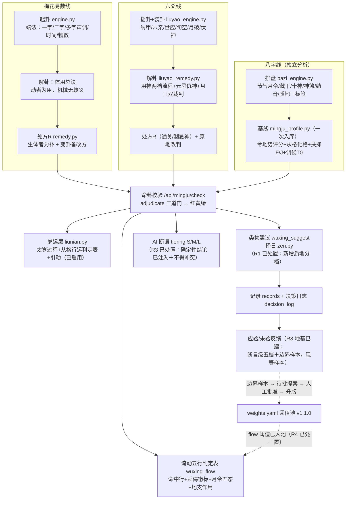

# 产品逻辑链框架（后端全景 v1）

> **三链总纲（站长 2026-09-25 定稿——集大成框架）**：
> - **底账**：八字命局＝出生时刻自身之气的定基（排盘、强弱、调候、格局，一次入库）。
> - **判运链**：占卜（梅花、六爻；将来奇门、大六壬）＋命家岁运（大运流年升降档）——判"当下这件事的气与自身的气生克如何"，用命家时间口径（十载一宫、逐岁推移）。
> - **改运链**：医家五运六气（天地气背景＋健康起居调养，**不进吉凶升降档**）＋空间环境气（经纬度→五方之性；二期户型风水）＋建议层（择日、方位、饮食）——用医家时间口径（岁半两段＋六步），与判运链各用各家、不并账。
> - 干支五行是三链的共同语言；两链结论并列展示于"气盘"，不做跨链加减。
>
> **2026-09-26 裁定记录（奇门·大六壬开工配套，详见判据总表第五节）**：
> 1. 奇门定局**单选拆补法**；范围＝数理奇门（传统古籍排局），转盘为主、飞盘并收；转盘禽星寄坤二（秘笈大全口径）；飞盘神盘/值使落中五**采启悟口径**（九神含太常、落中五寄宫）。
> 2. 大六壬**贵人起法＝甲戊庚牛羊**；**月将换将＝中气交节时刻后换将**（六壬大全/大六壬指南口径，非金针的整日简化）。
> 3. 奇门/六壬的**判运接入＝甲**：先起局＋格局吉凶标注＋与命局生克展示（书证标注），**暂不接裁决链升降档**。
>
> **2026-09-26 移植工作假设（站长采纳，跨星球移植设计原则，非判据）**：
> 1. **天文起源说**（圭表测影→八节→八卦；陶寺圭表、仰韶八角星纹为实物支撑，陆思贤、冯时一系天文考古学派）采纳为**移植设计的工作假设**：八卦底层＝对一年太阳视运动周期的八等分编码。层级＝**学说非定论**（「八卦=八节编码」这一步无直接证据链），只作移植设计依据，不进判据总表。
> 2. 各术数的移植接口按「地球常数绑定深度」分四级：抽象数理层（原样带走）→干支历法层（重锚参数）→星名借用层（换星表名＋重定规则，不观测天空：紫微变星盘、奇门九星）→真实天象层（重建天球观测：六壬月将、六爻纳甲月相）。
>
> **用途**：整个产品第一次框架性梳理——三条线（梅花 / 六爻 / 八字）从起卦到改运每一步用什么知识点、跑在哪个模块、产出什么数据、有什么书证、留了什么问题。以后"添这里删那里"之前，先看这张图定位。
>
> **读法（标记约定）**：GitHub 不支持文字着色，用徽章式 emoji 代替：
> - 🔴 **红色**＝已确认的结构性问题（影响结论正确性 / 违反既定原则），需排期处理
> - 🟡 **黄色**＝已知不确定点（逻辑自洽但无完全书证 / 数值未经校准 / 外推），用前须知
> - 上面两色**现在只出现在第 6 节台账的历史叙述里**（记录问题当时的样子）；§1–§5 的正文表格已于 2026-09-18 按台账同步为 ✅。**冲突时一律以台账为准。**
> - 证据等级：📜＝典籍直接条文（可逐字回源）｜🔢＝典籍给排序、数值为工程默认｜🧩＝体系内类比外推（无直接条文）
> - ✅＝有 pytest 覆盖；模块名后括号内为测试条数
>
> 风险编号 **R1–R10** 在正文中插在它实际所在的位置，第 6 节汇总成台账。前端部分本版不梳理（后续另出一版）。
>
> ---
>
> **文档状态（2026-09-18 同步一次）**：§1–§5 的表格先前把 R1–R8 标成 🔴/🟡 **未处置**，而**第 6 节风险台账更晚、更准**——现已按台账逐条同步为「已处置」。当前**真正还没做**的只有：**R11**（生边三值化，已立项未开工）、**R3 的后续**（AI 输出回检）、**R5／R7 的前端展示收尾**、**R12-d 的两项待决**（到期提醒走不走邮箱、失联率显示）。
> 另三点也已过时，一并更正：**校准闭环三层已接线**（边界样本 → 待批提案 → 人工批准，现等样本）、**flow 阈值已入池** `weights.yaml v1.1.0`（R4）、pytest 当前 **329 全过 / 0 跳过**、书证键 **46 条**全部逐字回源通过。
> 台账正文里出现的 "pytest 228／312 全过" 是**该轮当时的快照**，逐轮递增，不是当前值。

---

## 0. 一页总览

**主干一句话**：卦侧产生"处方五行 R"→ 八字基线提供"三张清单（喜用F/忌神J/调候T0）"→ 校验链裁决红黄绿并可能改方 → 建议层落地成物品/日期 → 记录层留快照、收反馈；反馈经**边界样本 → 待批提案 → 人工批准**反哺阈值池（三层已建，现等真实样本）。

---

## 1. 三线共用的改运主干（先讲公共部分）

校验链是三条线汇合的地方，先单独讲清，后面两条卦线只讲"R 怎么来"。

### 1.1 命卦校验（`wuxing_relation.py` · ✅11 测试）

| 步骤 | 知识点（术语＋白话） | 书证 | 证据等级 |
|---|---|---|---|
| 门1 忌神 | 处方R落在忌神J上→红牌拦截，改方 | 扶抑取用（旺则抑泄耗/弱则印比扶） | 📜 |
| 门2 调候转急 | 命局过寒/燥＋当令月令激活→"火烧眉毛"最高优先；R逆调候→红；R同调→升格 | 《穷通宝鉴》调候（TIAOHOU 表，干支×月支→用神次序） | 📜 |
| 门3 喜用 | R克F→红黄警示；R生F/同F→顺 | 同门1 | 📜 |
| 改方 redirect | 被拦截时按 F 优先重开处方 | 工程规则（服务于门1-3） | 🔢 |
| 红黄绿 | 顺/平/逆三档结论 + 决策文字 | 工程聚合 | 🔢 |

**岁运层**（`liunian.py` · ✅20 测试，**已启用**——旧说法"插口留而不启"已过时）：

| 步骤 | 知识点 | 书证 | 证据等级 |
|---|---|---|---|
| 太岁过秤 | 流年五行先被**起卦当月月令**称重（旺相休囚死），囚死近乎不计 | 《渊海子平》/《五行大义》五态 | 📜序+🔢值（weights.yaml v1.0.0，声明"未经案例校准"） |
| 从格行运表 | 从儿/从财/从杀/从势/专旺/化气 × 来运五行 → good/warn/bad 查表 | 《滴天髓》从象/化象/假从/从儿章（已固化成判定表） | 📜 |
| 引动 | 忌神当值或资敌→降档；喜用当值→升格；与转急调候同调/相逆→复用主裁决逻辑 | 同上＋扶抑 | 📜 |
| 边界 | 只升降一档，**绝不设 block、绝不改 R** | 工程约束（守"精准"原则） | 🔢 |

### 1.2 流动五行判定表（`wuxing_flow.py` + `wuxing_quality.py` · ✅20+15 测试）

补某五行时四条管道的配套：进气（生我·印）/出水（我生·食伤）/我克（财）/克我（官杀）。

| 环节 | 知识点 | 书证 | 证据等级 | 风险 |
|---|---|---|---|---|
| 状态分档 classify_state | 命局数量+月令+格局 → 弱/弱极/中和偏旺/旺极，**只显示命中行** | 《元理赋》序关系（强弱四态由书理支撑） | 📜序+🔢阈值 | ✅ **R4 已处置**：阈值（1.0／3.0／6.0，及乘侮带宽、月令加成、藏干权重）已入 `weights.yaml v1.1.0`，可版本化、可做敏感度分析，台账已记 `weights_version`（见 §6 R4）。**遗留**：单行显示仍缺"查看全部档位"折叠作对照 |
| 乘侮徽标 ke_triple | 克三值化：**攻守比值**判态——ratio 偏大→乘；偏小→侮；势均带内→正克 | 《素问·五运行大论》四路径（太过侧两条＋不及侧两条）＋《元理赋》克边成句对证＋《梅花易数·五行乘侮》图解 | 📜序（势均锚点"制则生化"）＋🔢δ | ✅ **已按"量级调制器"处置**（见 §6 R5） |
| 月令五态 month_state | 旺相休囚死（含四季土月土旺金相） | 《五行大义·论四时休王》＋《卜筮正宗·四时旺相》 | 📜 | — |
| 地支作用 branch_actions | 补X之支（金=申酉）×命局四支 → 六冲/六合/三合成局/半合 | 《子平真诠》会合冲＋《三命通会·论六合》＋《增删卜易·六冲章》 | 🧩（书证主语为命局/卦内对象，"补益行为"侧为类比外推） | ✅ **R6 已处置** |
| 阴阳细分 | 该五行一对天干的药性之别（庚顽钝宜炼/辛温润乐水） | 《滴天髓·论天干》十干体象（逐干原文） | 📜 | — |
| 质别/总则 | 金要炼、木分死活、火贵既济、土无常性、水须堤防；太满则倾、金郁泄之 | 穷通宝鉴各论＋三命通会＋内经·五郁 | 📜 | — |

---

## 2. 梅花易数线

### 2.1 起卦（`engine.py` · `/api/meihua/divine`、`/api/meihua/divine/pro`）

| 步骤 | 知识点 | 书证 | 证据等级 |
|---|---|---|---|
| 端法取卦 | 一字占/二字占/多字占（声调）/时间占（年月日时加时取爻）/物数占 | 《梅花易数》起例（先天卦序乾一兑二…，动爻取余）。**口径：先天数起卦，后天数断方位**——数与期（成卦总数/速缓）用先天卦数，方位之象一律取后天（五行方位出《五行大义》，八卦方位取乾西北…坤西南）；全库无一处用先天卦位（乾南坤北）取象，术语库有专词条「先天方位与后天方位」 | 📜 |
| 意图识别（`intent.py`，规则优先+AI兜底） | 问什么事→断语方向（不进判定） | 端法释义 | 🔢 |

### 2.2 解卦

| 步骤 | 知识点 | 书证 | 证据等级 |
|---|---|---|---|
| 体用定分 | **动爻所在之卦为用、静者为体**——机械确定，与问事无关（这条是当初选梅花体用的原因） | 《梅花易数·体用总诀》 | 📜 |
| 体用生克五档 | 体克用/用克体/比和/体生用/用生体 | 同上 | 📜 |
| 互卦/变卦 | 变卦克体→备改方 R_alt | 同上 | 📜 |
| 卦气旺衰 | 体卦宜旺、生体之气宜旺、克体之气宜衰 | 《梅花易数·心易衰旺诀》 | 📜 |
| 应期 | 先天卦定应期（卦气旺相之日） | 《梅花易数·占卜总诀》（`yingqi.py` ✅7 测试） | 📜 |

| 应期 | 先天卦定应期（卦气旺相之日） | 《梅花易数·占卜总诀》（`yingqi.py` ✅7 测试） | 📜 |

**主体怎么定（两条·站长定则，2026-09-21；同日由四条改为两条）**：上面的"体用定分"只解决了**卦内**的机械判定；这两条解决的是**卦与现实的对应**——体到底代表谁，以及判定何时生效。由站长口述定则，前端「万物类象·手动起卦」面板同文展示：

1. **第一念最重要。** 起卦那一刻的第一念是「这只鸟会怎样」，还是「这兆头对我怎样」，还是「同行那人会怎样」？第一念决定主体；事后反推主体，容易牵强附会。
2. **动爻所在的卦为用，另一卦为体**——卦内体用。体代表求测者，用代表所问之事、外部环境、对方。（此条即引擎现行规则，机械判定）

> 性质：第 2 条是引擎现行规则（📜），第 1 条是**使用指引**（站长定则，非典籍条文，不作引证）。原第 1 条「谁问事，谁为体」与原第 3 条「外应不等于主体」已由站长删去——体代表谁由"第一念"定，不在页面另列规则；外应的用法在结果页「断卦次序」第三步（克应／外应参断）里讲，不与体用混列。
>
> 配套改动（同日）：因"万物起卦让 AI 猜主体"既复杂又不准，AI 起卦入口已由站长决定**移除**，改为「万物类象·手动起卦」——用户按《八卦万物属类》（`/api/meihua/gua_wanwu`，逐字回源）自己指定上下卦与动爻。结果页设「断卦次序」区，照《占卜总诀》原书顺序（爻辞→体用→克应→己身动静→总断）结合本卦数据展现；「物数占」按钮同日删除（它与《八卦万物属类》是两套机制：一个用数出的数量、一个用事物的类象）。页面不再列起卦取数规则与「起卦算法摘要」表（2026-09-22 站长决定删除）；取诸物起卦的底本条文只在 `books/meihua/梅花易数.txt` 底本中（L486-488 物数占例、L494-496 声音占例、L712-718 取诸物、L748-752 来人方位、L766-768 占动物、L786-788 占静物、L800-802 端法总则），页面与代码都不再抄录，代码注释只保留"该表已删"的说明。

### 2.3 改运

| 步骤 | 知识点 | 书证 | 证据等级 | 风险 |
|---|---|---|---|---|
| 处方R派生（`remedy.py`） | 补"生体之五行"（泄用神之气/扶体卦） | 衰旺诀逻辑推论 | 📜 | — |
| 命卦校验 | R 进入 §1.1 主干 | — | — | — |
| AI 断语 | 档位 S/M/L 累积输出（`tiering.py` ✅） | 工程分层 | 🔢 | ✅ **R3 已处置**：`deterministic_conclusion()` 已把裁决档位、大忌清单、岁运效果、命中档位、质地取向注入梅花与六爻提示词，并附「不得冲突」三条约束（见 §6 R3）。**遗留**：尚无 AI 输出回检（冲突打分） |
| 卦侧精度 | 卦身只用到**五行档**（乾兑金…）；阴阳（震阳木/巽阴木）梅花本身可分但未用；燥湿寒暖按 md 方案应从起卦时间干支侧写——未做 | A 档方案（tabbit md 定案） | — | ✅ **R2 已处置**（卦侧一半）：梅花按起卦日支寒燥取向、六爻用神爻干支直给质地取向（见 §6 R2） |

---

## 3. 六爻线

### 3.1 起卦/装卦（`liuyao_engine.py` · ✅4+3 测试）

| 步骤 | 知识点 | 书证 | 证据等级 |
|---|---|---|---|
| 三枚摇卦 | 六次摇爻，seed 可回放（`liuyao_coins`） | 工程设计 | 🔢 |
| 纳甲装卦 | 八宫归属、纳干支、六亲、世应 | 《卜筮正宗》装卦定例 | 📜 |
| 旬空 | 日柱旬空（六爻语境核心机制：填实/冲空/真空假空） | 《增删卜易》旬空章 | 📜 |
| 月破/暗动 | 月建冲爻、日辰冲静爻 | 《增删卜易》/《卜筮正宗》 | 📜 |
| 伏神 | 用神不上卦→查伏神链（✅3 测试） | 《卜筮正宗》飞伏神定例 | 📜 |
| 六兽/藏干 | 六兽起例、地支藏干 | 同上 | 📜 |

### 3.2 解卦（`liuyao_remedy.py` · ✅28 测试）

| 步骤 | 知识点 | 书证 | 证据等级 |
|---|---|---|---|
| 用神两档流程 | 高置信（精确命中关键词）→直断+结果页判定依据+事后改判；低置信/多候选→起卦前气泡二选 | 《增删卜易·用神章》封闭枚举（自占→世爻；父母/兄弟/子孙/妻财/官鬼六亲取用） | 📜 |
| 元神/忌神/仇神 | 生用神者元神、克用神者忌神、生忌神者仇神（判定链条） | 《增删卜易·用神章》 | 📜 |
| 月日双裁判 | 月建定状态（旺相休囚）、日辰管动态（生克冲合、暗动日破） | "月建乃万卜之提纲，日辰为六爻之主宰"（《卜筮正宗》/《黄金策》体系） | 📜 |
| 贪生忘克 | 中间五行把攻击改道成输送（通关在六爻侧的原生形态） | 《增删卜易》/《卜筮正宗》 | 📜 |

### 3.3 改运

| 步骤 | 知识点 | 书证 | 证据等级 | 风险 |
|---|---|---|---|---|
| 处方R | 通关/制忌神方向派生 R（`/api/liuyao/remedy` 支持改用神后原地重算） | 元忌仇神链＋贪生忘克 | 📜 | — |
| 命卦校验 | R 进入 §1.1 主干 | — | — | — |
| 卦侧精度 | **六爻纳甲每爻带地支（干支级信息全量在手）**，但进 check 的只有处方五行档——命局侧已升干支级（质地/合冲），卦侧一字未动，两侧精度不对等 | A 档方案 | — | ✅ **R2 已处置**：乘侮改用藏干加权力量（本气1/中气0.6/余气0.4）、补齐天干五合、卦侧干支入链（见 §6 R2）。**遗留**：六爻其余爻（世／动／忌神）干支尚未全量入链 |

---

## 4. 八字线（独立分析）

### 4.1 排盘层（`bazi_engine.py` · `/api/bazi/paipan` · ✅12+6+7 测试）

| 步骤 | 知识点 | 书证 | 证据等级 |
|---|---|---|---|
| 历法 | 公历/农历互换（lunar-python）、夏令时还原、真太阳时（经度＋均时差） | 天文历法 | 🔢 |
| 月令 | 以**节气**定月（立春起寅月），非农历月初 | 子平通行 | 📜 |
| 四柱 | 干支、藏干（人元）、十神（含比肩/日主之别）、神煞、大运顺逆＋流年；纳音与命宫/胎元/身宫**仅展示、不进判定**（纳音出自河图生成数，存先天之象——与空亡"仅展示"同款式） | 《渊海子平》体系 | 📜 |
| 空亡 | 日柱旬空——**八字语境缺触发机制，仅展示不进裁决**（六爻侧相反，是核心） | 《子平真诠》批评＋工程边界 | 📜+🔢 |
| **质地层三标签**（新增） | 每个干支挂 阴阳·寒暖·燥湿：阴阳＝十干体象逐干原文；寒暖＝天干金水寒木火暖＋任氏十二支寒暖表；燥湿＝**按载体分列、不跨载体互推**——湿/燥为书证赋值（丑辰湿土、未戌燥土、亥子湿、巳午燥），申酉标**歧异**（方位层"西北为湿"vs原注"金燥而宜湿"，分列不择一），寅卯标**条件性**（缺逐支条文，随局中水火与干支相配定） | 《滴天髓》论天干/寒暖/燥湿三章＋任注"燥湿者，水火相成之谓也"（`wuxing_quality.py` ✅19 测试） | 📜 | ✅ **R7 已收口**（"平"退场） |

### 4.2 基线层（`build_xiji` → `mingju` dict，一次入库终身不变 · `mingju_profile.py`）

| 步骤 | 知识点 | 书证 | 证据等级 |
|---|---|---|---|
| 三步评分 | 得令（月令旺相）0.5＋得地（通根）0.3＋得势（党众）0.2 → F 值 | 书给"得时为旺、党众为强"（《子平真诠》论旺衰）的**排序**；权重为工程默认 | 📜序+🔢值 |
| 从格/化格四查 | 化气（日干五合＋化神得令）→从儿→专旺→从弱，真/假分级，逐条书证 ge_basis | 《滴天髓》从象/化象/假从/从儿章 | 📜 |
| 扶抑取用 | 旺则抑泄耗、弱则印比扶 → 喜用F/忌神J/闲神/仇神 | 子平扶抑 | 📜 |
| 调候T0 | 干支×月支 → 用神次序表 | 《穷通宝鉴》TIAOHOU 表 | 📜 |
| 基线数据 | wuxing_tally（五行数量）、gans/zhis（四干四支，供地支作用）、month_wx/month_zhi、from_ge/ge_quality/effective_wx | — | — |

### 4.3 校验链（每次起卦动态跑，见 §1）＋ 档案层

| 步骤 | 说明 | 风险 |
|---|---|---|
| 档案存储 | SQLite，uuid 不可变＋schema_version，ALTER 只增列平滑迁移 | — |
| 导出/导入 | 前端 WebCrypto AES-GCM 加密信封，密码不经服务器；导入基线由出生信息现算（不信任文件） | — |
| 决策日志（`decision_log.py` ✅7） | 每次校验存完整推理链快照＋rules_version＋weights_version——事后归因锚点 | 🟡→✅ **R8 地基已建（待样本）**：三层已接线——断言级反馈、边界样本、护栏内"待批"提案（**人工批准才改数**）；现等真实样本，样本不足则不提案（见 §6 R8） |
| 记录（`records.py` ✅10） | 起卦/排盘快照、可回放、软删除30天、反馈附件 | — |

### 4.4 建议层

| 模块 | 知识点 | 书证 | 风险 |
|---|---|---|---|
| 类物建议（`wuxing_suggest.py`＋`wuxing_xiang.json`） | 方位/颜色/数字（河图）/物件/饮食/职业/健康/卦象/屋宅/四时/干支 | 五行大义/说卦传/内经/梅花·八卦类象（汇辑库，带 src 键可回源） | 🔴→✅ **R1 已处置**：新增「质地分档」维度——两味分列（庚／辛、戊／己）＋本味推荐＋约束（补金须配水润、土分湿燥），体象📜＋物件归类🔢，随 src 回源。**遗留**：物件清单尚未按味细分（待更多书证） |
| 择日（`zeri.py` ✅6） | 宜忌日期表（卦气旺相应期＋喜忌序关系，逐日给理由＋出处） | 梅花·先天卦定应期＋旺相休囚 | — |

---

## 5. 数据契约与检验点（`/api/mingju/check` 响应字段分级）

> 检验原则：**裁决层**字段（影响红黄绿/改方）必须有书证＋测试；**显示层**字段（只影响展示）允许工程默认但须标注。

| 字段 | 层级 | 来源模块 | 检验 |
|---|---|---|---|
| R / final_R / redirect_note | 裁决层 | remedy/liuyao_remedy + adjudicate | ✅ |
| adjudication.net/level/gate/hits | 裁决层 | wuxing_relation | ✅11 |
| liunian.effect/strength/notes | 裁决层（只升降档） | liunian | ✅20 |
| baseline.F/J/T0/from_ge/tier | 裁决层（静态基线） | bazi_engine + mingju_profile | ✅12 |
| flow.state（命中档） | **显示层** | wuxing_flow.classify_state | ✅ 有测试；**阈值已入池 v1.1.0（R4 已处置）** |
| flow.cells[].chengwu（乘侮） | 显示层 | wuxing_quality.ke_triple | ✅ 有测试；**已定为"量级调制器"，不新设优先级（R5 已处置）** |
| flow.month_state（月令五态） | 显示层 | wuxing_quality.month_state | ✅（📜） |
| flow.branch_notes（地支作用） | 显示层 | wuxing_quality.branch_actions | ✅ 有测试；**外推类已按 R6 三步处置（句降级／条目标注／句式固化）** |
| flow.yinyang.items（阴阳细分） | 显示层 | 滴天髓·论天干 | ✅ |
| suggestions（类物建议） | 建议层 | wuxing_suggest | ✅ **已加质地分档（R1 已处置）**；物件清单待按味细分 |
| date_table | 建议层 | zeri | ✅6 |
| log_id/rules_version/weights_version | 留痕层 | decision_log + rules_meta | ✅7 |

---

## 6. 风险台账（R1–R15，按处置状态汇总）

> **状态语义**：✅ 已处置／已落地＝已有修法，且配了测试或实测；🟡 部分／待样本＝地基已建，仍等外部条件（如真实反馈量）；⏳／🆕＝已立项、未开工。
> **本表是"当前状态"的唯一出处**（§1–§5 已按它同步）。表内正文里的 pytest 数字是**该轮当时的快照**，逐轮递增，当前值见开头「文档状态」块。

| 编号 | 级别 | 位置（链路节点 → 模块） | 问题 | 缓解现状 | 出路 |
|---|---|---|---|---|---|
| R1 | ✅ 已处置（**含 2026-09-19 的味级细分**） | 建议层 → wuxing_suggest | 精度未达建议物品本身（五行级静态） | **已修**：新增「质地分档」维度——两味分列（庚/辛、戊/己）＋本味推荐＋约束（补金须配水润、土分湿燥），体象📜＋物件归类🔢，随 src 回源。**丙·4 再降一层到「味级器物」**：`STEM_OBJECTS` 给十干之名与其物（庚＝斧钺之金／辛＝首饰之金，📜《滴天髓》七·八章题、《增广校正梅花易数》、《图解三命通会·论十干》），`flavor_split` 按阴阳拆成两列 | 剩：`srcs` 已是**可解析的出处键数组**（前端逐个渲染成可点开的原文摘录），新引 7 条已进逐字回源；跨载体不合并的规矩见 R6+R7 元规则 |
| R2 | ✅ 已处置 | 六爻改运→check（主）；梅花卦身（次） | 卦侧仍是五行级，与命局侧精度不对等 | **已修**：① 乘侮改用藏干加权力量（hidden_tally，本气1/中气0.6/余气0.4）；② 补齐天干五合（干支级干侧作用）；③ 卦侧干支入链——六爻用神爻干支直给质地取向，梅花按起卦日支寒燥取向 | 后续：六爻其余爻（世/动/忌神）干支全量入链 |
| R3 | ✅ 已处置（**提示词约束 + 程序回检两层**） | AI 断语 → main.py 提示词；**回检 → aicheck.py** | AI 与判定层无一致性约束 | **已修**：`deterministic_conclusion()` 把裁决档位、大忌清单、岁运效果、命中档位、质地取向注入梅花 divine/divine_pro/chat 与六爻 divine 提示词，并附「不得冲突」三条约束；前端补传 profile_id。**但提示词约束是软的**——模型可以换种说法绕开，故 2026-09-19 补上 `aicheck.py`：**判定级**（日期越界，白名单＝代码算的应期表 ∪ 用户提问里点名的日期）＋**提示级**（越档／措辞偏离，必然误报故只进日志、不上屏、带原文片段）。接线在四个流式端点（含多轮追问——那才是"顺着话头漂"最容易发生的地方）。**书名越界为第三类（判定级）**：提示词「素材边界·三」把"能引什么"钉成封闭集合，判据不另编白名单、直接拿提示词自己当基准。**⚠️ 基准＝模型实收的全量**（system ＋ 每一个 user 素材块，含末尾追加的确定性判定层），统一走 `main._review_base(...)`——初版只传 system 一段，把六爻十干表里**我们自己标明的**《滴天髓·论天干》判成编造并推上屏（判定级），是假案；四个调用点另有一条**源码级**测试盯着不许绕过它。**同源的第二处矛盾**：两条线的第三条白名单只列本线典籍，而 user prompt 里都接了十干表、表头写着子平线书名——表说"照此引用"、白名单说"只许引这两本"，模型两头受命。已按甲案各补「及【十干体性与润燥】一节表头所标《滴天髓·论天干》」并写明边界就在这一节（该书其他篇名照拦）。**同族第三件事：输出截断**（2026-09-19 修）——AI 输出撞 `max_tokens` 上限时此前**完全静默**（`_stream_llm` 把 `finish_reason` 整个丢掉，前端当正常收尾、记录照存），现改为收下 `finish_reason`、发 `truncated` 事件、前端显示「解读未写完」；每个调用点传 `state` ＋恰好一处上报，有源码级测试盯着。**上限本身（4096 tokens ≈ 5250 汉字）是否提到 8192 待站长定** | 语义级改写机器不判（要判就得再上一遍 LLM，等于用不确定校验不确定），**长期留给人看**，见「产品流程总图」丙·4 |

| R4 | ✅ 已处置 | 流动表状态分档 → wuxing_flow | 阈值未入池；单行显示成单点故障 | **已修**：阈值入 weights.yaml（v1.1.0）`flow_thresholds`（状态分档/乘侮边界/月令加成/藏干权重），可版本化、可做敏感度分析；决策日志已记 weights_version。**"单点故障"这一半也已修（丙·3①）**：后端改为**四档全出、只有命中档标 `active`**，前端默认仍只显示命中行，另有「查看全部档位」展开（非命中行压暗＋虚线＋标「假设」）。**边态（乘侮／生害）只挂命中档**——它们按这盘真实力量分布算，挂到假设档上等于说"换一档量级修正也一样" | 回归测试 `test_only_active_row_carries_edge_state_modifiers` 锁住"假档不带边态"；无档案时仍一行强弱都不出 |
| R5 | ✅ 已处置 | 乘侮徽标 × 静态格 | 同格两套结论可能矛盾，无优先级规则 | **已修**（不新设优先级体系）：乘侮定位为静态格的**量级调制器**——方向由静态格给、量级/时机由边态修正；边态命中（乘/侮）时静态格禁止裸输出，渲染为复合句「方向：宜少量·成器｜量级修正：乘（克制过度：须减火，或添土通关）」；仅当方向与量级**不同源**（静态格开此克却判乘、忌此克却判侮）时出 ⚠ 告警复核，不静默择一 | **前端已实测**（丙·3①，2026-09-19）：四档全出后展开「查看全部档位」，命中行高亮标「命盘当前」、其余三档压暗标「假设」，复合句与 ⚠ 告警照常渲染 |
| **R5·边界** | ✅ **已修（2026-09-18）** | **R5 告警判据过宽：把"同向确认"误报成"不同源冲突"** | 告警判据只看 `grade` 字面（忌/大忌），**不看"忌"的理由**。而「忌」有两种来源、语义正相反：**忌「克不动」**（攻方太弱，克了白克反受其伤）与 **忌「逆势」**（格局不可逆，此克**有效且有害**）。前者与边态的「侮」（克制不成立）**是同一个判断**，出告警等于在说"我跟你讲的是同一件事"。**站长核查实证**：静态枚举 26 条 `grade∈{忌,大忌}` 的克边 → 构造命局逼出「侮」→ 实出告警 **21 条**；逐条看理由文本，**15 条**属"克不动/自伤"一路（误报）、**6 条**属"逆势/破格"一路（真冲突） | **已修**：新增 `ANTI_KE_CELLS`（`wuxing_flow.py`）——**逐条回源**列出属于《元理赋》**反生反克组**的格位（17 个 `(五行,状态,关系位)`）；判据加 `and not anti_ke`。压制时**不静默**：写 `conflict_suppressed` 记明"为何这次不告警"。**典籍依据**：《图解滴天髓·下部》引《元理赋》一组二十句并明确定名**反生反克**（"金能克木，木坚金缺……木弱逢金，必为砍折"，后十句正是本表弱/弱极档两条克边的判词来源），同书点出反克成立条件为"五行**得势**……木得势则反克金"——**与 `ke_triple` 判「侮」的 `d≥a+margin` 是同一判据**（`ke_triple` 自己的 docstring 亦写作"侮（反克，克制不成立）"）。而格局侧依据在顺逆，与反克无关（《穷通宝鉴评注》"格成专旺……不欲见火"；《滴天髓·专旺五格》曲直忌西、炎上忌西北、从革忌南、稼穑忌东北、润下忌东南）→ **方向相反，继续告警** | 回归测试 `test_conflict_suppressed_for_antike_cells`（三条：反克组不告警且留理由／格局侧仍告警／**边界不扩大**——木火金「弱极·克我」判词是"顺势（从格）另判"，属从格一路，不得误收进豁免集）。**待议已决（同日）**：火·旺极(从格)·克我 判词原为「见水为杯水车薪反激其焰，激之则破格主不测之祸」——一句里缝了两义。**站长定：分列两说、各标出处、不替人择一**（同 R7 处理申酉燥湿"歧异"的做法）。**核书时更正了我原先的表述**：两说**并非对立**，而是**一家说机理、一家说条件与后果**——《滴天髓·体用》任铁樵注（总则）「旺极者抑之，**抑之反激而有害**，则宜从其强而扶之」（机理：此克不成立），《穷通宝鉴·炎上格》既说「见水为杯水**舆**薪，**反激其焰**」（同机理），又说「炎上格虽有木引化，亦不可见水运，**成方成局**……**见水激之则破格，主有不测之祸**」（条件与后果：成局时此克会破格）。**告警保留**——因"成局破格"一说与「侮」方向相反，此处确实值得复核；但判词改为把两说与出处都摆出来。**连带修两处出处缺口**：新增出处键「滴天髓·体用」（此前「滴天髓·阴阳颠倒」只收了**弱极**那一半"弱极者扶之，徒劳无功，反有害也"，**旺极**这一半一直无键可引，故该格只能挂《穷通宝鉴》一家）；「穷通宝鉴·炎上格」原文摘录补上"成方成局……见水激之则破格"后半（原摘录只到"反激其焰"，会让读者以为该书只说克不成立）。两段新引文均过**逐字回源**回归 |
| R11 | ✅ **已落地（2026-09-19）** | 生边 → `wuxing_quality.sheng_triple` / `wuxing_flow.flow_plan` | 克边已三值化，**生边仍是二值**（《元理赋》"金赖土生，土多金埋"一类生多之害已有成句），体系偏侧 | **已修，与克边同构**：`sheng_triple(att, dfd)` → 正生／**母多灭子**（a ≥ d+margin）／**子旺侮母**（d ≥ a+margin），**共用** `chengwu_margin` 与月令加成——同构的东西用同一个势均带，否则读者会以为这是两套不相干的判据。出口键 `YUANLI_SHENG_MU`（按**母**索引：土多金埋／火多土焦／木多火炽／水多木漂／金多水浊）与 `YUANLI_SHENG_ZI`（按**子**索引：水多金沉／木盛水缩／火多木焚／土多火晦／金多土变），书证＝《元理赋》反生一组。接在两条生边上（进气＝母生我，出水＝我生子） | **生边不设冲突告警**：生害与静态格不是两套结论，而是**同一方向的量级修正**，故直接出复合句「方向：X｜生害修正：Y（…）」，不引入 R5 那类复核告警。前端**只在判出灭子／侮母时才显示**（"正生"是常态，常态上屏只会盖住真正要看的那两格），配色与克边乘侮同源。回归测试 `test_sheng_triple_three_values`／`test_sheng_triple_shares_margin_with_ke`／`test_flow_wires_sheng_three_on_both_sheng_edges` |
| R6 | ✅ 已处置 | 地支作用/干合 → wuxing_quality | "补力被冲减"以断言语气说了类比外推的话 | **三步处置**：①句子降级——断言主体让位给"传统"（"命局有寅申冲，传统上主散。补金时可另择时，或在合住之时（巳日合申）再补"），删除全部量化表述；②条目补标——出身/接口/边界三字段写死进条目元数据（出身=类比外推：书证主语均为命局/卦内对象；边界=不进裁决权重、不产生数值、不触发改判，欲升级须先回答"出身"一关）；③句式固化——外推类条目统一模板"命局有[X]，传统上主[Y]。做[Z]时可[…]"（套不进模板的外推命题＝想干裁决的活→退回补条文） | 回归测试锁定模板（含"无量化"断言）；层级归属不变（显示层） |
| R7 | ✅ 已核实收口 | 燥湿标签 → wuxing_quality | ~~"平"档是三种库内说法取交集的工程判断~~ **实质重述**：不是"用自造中性档填空白"，而是**把三个不同载体的陈述压成一张静态表、再用中性档抹平压缩产生的假冲突**；且漏读了《燥湿》原注"金燥而宜湿者，用金而后用水"——申酉并非沉默 | **已修**：燥湿改三态＋来源强度——湿/燥（书证赋值）／**歧异**（申酉：方位层"湿"vs原注"燥"，分列不择一）／**条件性**（寅卯：缺逐支条文，随局中水火与干支相配定）；"平"退场；新增出处键「滴天髓·燥湿·原注」「滴天髓·燥湿·载体分层」 | **前端分列已做（丙·3②，2026-09-19）**：八字页「补充信息」里新增「燥湿分列」块——一个载体一行、各挂出处（申：方位层→湿〔载体分层〕／原注→燥〔原注〕；寅：任注总纲→随局而定），不再压成一句「歧异（燥｜湿）」；只在真有歧异／条件性的柱出现，其余十支不占版面。实测：日柱寅（条件性）＋时柱申（歧异）同块并列渲染正确。**若将来调候/质地消费支燥湿，须先处理歧异/条件性** |
| **R6+R7 元规则** | 📌 归档（**2026-09-19 增第三个实例**） | 属性类规则（寒暖、燥湿、清浊）与作用类规则（冲合） | **同一条元规则的两个实例：条文有"主语／载体"之分，跨载体不得互推**——R6 是把"命局内部/岁运"的作用规则推到"补益行为"上；R7 是把"寒暖层"的陈述折算成"燥湿"。新增属性维度时先问：这句话的主语是谁、载体是哪一层；外推类条目一律走 R6 三步模板（句子降级/条目补标/句式固化） | 已并入框架，作为新增维度的准入检查项。**丙·4 又撞上它一次，这次是"合并"而非"外推"**：金的阴阳二分，**十干**（庚辛，《滴天髓》《三命通会》）与**八卦**（乾兑，《说卦传》《梅花易数》）两处各自成立，但**谁也不给谁作证**。旧代码把乾兑静物合参成一行"物件·静物"，等于替书上做它没做过的对应。`flavor_split` 改为**两列并列、各挂出处**，并把"方位／颜色／数字／五味在书上只到五行这一层"明写成一句——分不动的地方也要说清"分不动" | 每次新增维度走一遍"问载体"＋"过模板"＋**"这两列能不能合并"** |
| R8 | ✅ 地基已建（待样本） | 反馈闭环 → feedback.py + decision_log + weights.yaml | 原状：反馈只有整案级二值（应验/未验），**无归因、无局部性**，不能调任何数值 | **已建三层**：①**claim 级反馈**——每次校验落断言清单（裁决/风险/岁运/择日/关系/建议，各带归属规则·参与参数·可判定性·验证窗口），反馈五档「应验/未验/反向/无法判定/未观察」＋补充说明；②**边界样本**——判据值擦阈（≤band）自动记账，是唯一能喂阈值的样本来源；③**校准提案**——只在护栏内生成"待批"提案（最小样本/同向下限/±30%/人工批准），**绝不自动改数、不做拟合**；前端：右上角公测反馈入口＋校验条内逐条标记 | 待公测样本积累；联系方式＝**专用别名邮箱**（不用主账号，用户已定）——建好后填 `frontend/src/feedback/config.ts` 的 `CONTACT_EMAIL` 一行即可 |
| R9 | ✅ 已实测 | 前端 | scrollWithin/单行表/阴阳细分/质地行未做浏览器实测 | **Tabbit 浏览器走查通过**（真实 Chromium 全链路）：①首页右上角反馈入口/面板开关/空态/联系区隐藏逻辑 ✓；②八字排盘"质地"行 8 干支渲染（含申酉"歧异（燥｜湿）"、寅卯"条件性"新档）＋存档案 ✓；③梅花起卦全链路——流动表单行＋"命盘当前"标记、阴阳细分两味、月令五态、乘侮徽标、质地分档（时令取向"寒湿取戊土"）、逐条反馈 7×5 档 ✓；④滚动：流式期间 window.scrollY 稳定（仅保留一次有意的结果区定位）✓；⑤记录命名：有问句=问句、无问句回退卦名 ✓；⑥反馈面板：两条校验列出、标记持久化 ✓。**走查抓到并修复 1 个真 bug**：S/M/L 维度白名单漏了"质地"，M 档问题把质地块整个滤掉（已修：质地随"物件"入 S 档） | 截图接口在带常驻动画的页面偶发超时（DOM 断言已覆盖，非功能问题） |
| R10 | ℹ️ | 认知澄清 | **岁运层已启用**（从格行运判定表+weights.yaml+20测试），"留而不启"为过时结论 | — | 无需动作，更新认知即可 |
| R12 | ⚠️ 已处置两轮 | 数据归属 → records.py / decision_log.py / mingju_profile.py / main.py / frontend | **公测级隐私洞**：`records.list_all()` 是 `SELECT *`，无 owner 过滤 → 任何访客都能看到所有人的记录（含"父亲的病情"这类内容）；档案 id 用 `Math.random()`+时间戳（可枚举），`/api/mingju/profile?id=` 无鉴权 | **第一轮（A 档）**：①令牌化——前端 `crypto.randomUUID()` 存 localStorage，随 `X-Owner-Token` 头自动带（`installOwnerHeader` 统一注入，杜绝漏改调用点）；②全链路 `WHERE owner=?`；③老数据改挂 `__legacy__`（客户端构造不出）+ `claim_legacy()` 运维认领；④空令牌映射 `__anon__`（数据层匹配不到任何行）；⑤限流。**第二轮（本轮，修第一轮的漏网）**：见 R12-b | 见 R12-b |
| **R12-b** | ✅ 已处置 | 端点守卫（`main.py` owner_of / require_self）+ 导入 + 备份 | **第一轮验证矩阵漏测出来的三个洞**：①**读/删/导出旁路**——`owner_of(request, id)` 在缺令牌时**退回用 query 里的 id 当归属**（本意是兼容老客户端把 id 放 query），于是"不带令牌 + 只带别人的 id"就让 `owner_of(...) != id` 恒为假，档案读/删/导出守卫**全部失效**；②**无令牌改写他人档案**——`/api/mingju/import` 端点没有 `request` 参数、无任何归属校验，而 `import_profile` 按**备份文件里的 id** 做 `ON CONFLICT(id) DO UPDATE`，于是"知道某个 id"就能把别人的出生信息改成任意值（**数据破坏**，比泄露更狠）；③**共享匿名桶**——校验端点用 `owner_of(request, profile_id)` 当归属，所有无令牌请求被写进同一个桶，而那个桶**任何无令牌请求都读得到**（A 能看到 B 的问事与完整推理链） | **修法**：①`owner_of` **彻底断开 fallback 鉴权**——客户端的 id 是**数据**不是**凭证**，两者混用是这类洞的通用成因；新增 `require_self(request, rid)` 用于档案端点（无令牌 403 并说明原因，令牌不符 404 与"不存在"同形，不做存在性探测）；②`import` 加 `require_owner` + 限流，`import_profile(data, owner)` **归属只取令牌、绝不采信文件里的 id**，uuid 被占用则重新生成；③校验端点改为"**照常算、无归属则不落账**"——校验是无状态计算，为补一个洞把功能砍掉（直接 403）是过度反应 | **端点级回归 18 条**（`test_owner_scope.py`，走 HTTP 而非直接调库——上一轮全是数据层测试，**结构上就测不到端点守卫写错**，这正是漏网原因）；**对运行中服务实测 17/17**（无令牌读/删/导出 403、伪造导入 403 且 A 档案仍是 1990、他人导入只写进自己名下、无令牌校验 200 但不落账）；pytest **209 全过** |
| **R12-c** | ✅ 已处置 | 备份完整性（`records.export_all/import_all`、`decision_log.export_all/import_all`） | 「备份与搬家」**名不副实且搬家不通**：只导出命局档案，**记录与校验台账一个都不带**（用户攒的卦例、手写的应验判定全丢）；且导入后档案挂在**备份里的 id**（= 导出设备的令牌）下，而新设备令牌是另一串 → 新设备用自己的令牌读它得 404，**导入成功的返回是假象**，用户看到的是"还没有档案"。**外加一个自伤**：既然档案主键就是令牌，那么"照原样导出"会把**一枚仍然有效的凭证**写进文件——用户很可能选弱密码再存网盘，解开文件的人不只是看到数据，而是能直接当成本人读写全部数据，等于把 R12 从备份这条路又开一遍 | **修法**：①备份扩为全量（档案 + 记录含回收站 + check_log/claim_feedback），格式升 `mj_backup: 2` 并兼容 v1；②导入**归属改写为当前设备**、记录 id 重分配（不撞本机既有行）、`claim_feedback` 的 log_id **同步重映射**（不映射会把别人的断言反馈挂到错行）；③**凭证字段一律抹掉**——导出时 `profile.id` 不写、记录与台账的 `owner`/`profile_id` 清空（这些字段在导入时反正会被服务端重写，留着只有风险），使"备份只搬数据、不搬凭证"这条规则**真正成立**；④导出密码 ≥4 位改 ≥8 位并加「生成密码」一键强密码，文案写明"4 位数字几秒可破"（原本文案用"经 AES-GCM 加密"暗示了不存在的强度：PBKDF2 15 万次迭代对 1 万种可能的短密码没用） | 实测（浏览器，对运行中服务）：导出含 22 条记录（16 可见 + 6 回收站）、88 条台账、1 条断言反馈；**载荷中不含令牌**（`tokenAppearsInPayload: false`）；新设备导入后档案+记录+台账全部可见且反馈没挂错行，`owner`/`profile_id` 均为新设备；站长数据完好 |
| **R12-d** | ✅ 已落地（①③） | 长期反馈的触达（iOS 存储 7 天上限）→ `frontend/public/manifest.webmanifest` / `common/owner.ts` / `decision_log.py` 回执表 / `FeedbackPage.tsx` | **A 档「设备即账户」撑不到长验证窗口**：WebKit 官方明确"7 天无用户交互即删除该站全部 script-writable 存储（localStorage/IndexedDB/SessionStorage/Service Worker）"，例外是**加到主屏的 web app**；而 claim 级反馈的价值恰恰在长窗口（岁运/择日按周、按月甚至跨年）。**且当时根本没有 manifest**：没有它，"添加到主屏幕"仍以 Safari 打开，那道豁免拿不到 | **已做两件（另两件待发话）**： **① 让令牌活得久**——补 `manifest.webmanifest`（standalone + 192/512/maskable 图标，Pillow 生成的三爻金标，与顶栏品牌位同一符号）+ `apple-mobile-web-app-*` 三个 iOS 私有 meta（iOS 不读 manifest 的 display 做全屏）+ `theme-color`；`requestPersistentStorage()` 在启动时申请持久化（Firefox 弹窗、Safari/Chromium 按交互历史静默批准）；RecordsPage 加一条**只在真正受影响时出现**的加主屏提示（iOS + Safari + 未装成 App + 没关过；桌面端不提示，因为那边没这限制，提示了只是噪音）。 **② 让断言能等到那天**——`claim_receipt` 表 + 三端点：`POST /api/feedback/claim/receipt` 签发（**幂等**：同一断言恒同一枚，否则"再次加入日历"会留一串死链；不接受跨人签发）、`GET /api/feedback/claim?receipt=` 落地页、`POST /api/feedback/claim` 接受 `receipt`。**持回执码可完全不带令牌作答**（这正是它存在的理由）；带 receipt 时客户端传的 `log_id`/`claim_id` **一律忽略**，归属与目标全取自回执行。前端每条断言两个动作：「到期提醒」生成 `.ics`（DTSTART=断言 `until`，VALARM 提前一天；描述含所问、断言、归属规则、书证与作答链接，带 BOM 防 Windows 中文乱码）、「复制作答链接」。 | **浏览器实测**：manifest 200 且 `display: standalone`、三枚图标齐全、`apple-mobile-web-app-capable` 与 `theme-color` 在位；台账入口展开得 60 行（校验/排盘两类）；回执码签发幂等、落地页只回该条断言（**不返回问题原文与其它断言**）、**裸 fetch（无令牌头）提交裁定 200**、回执页渲染出 5 个裁定按钮；全程无 console 报错。pytest **228 全过**（新增 5 条回执测试：无令牌作答、幂等与跨人签发被拒、忽略客户端目标、伪造码 404、回执不进备份） |
| **R12-g** | ✅ 已处置 | 遗留清理与限流加固 | ①`backend/test_liuyao.py` 在根目录、`pytest tests/` 从不收集，是"以为有覆盖其实没跑"的典型；②`_t0_flow.txt`/`_tk_probe.txt` 历史探针残留；③限流按 `request.client.host` 计数，挂反向代理后所有用户共用一个桶（一个人刷满全站被 429，防滥用变成连坐）；④`fetchLogs` 是死代码，而决策日志**根本没有回看入口**——数据一直在库里，缺的是最后一公里 | ①**没有直接删**：那个脚本装着 3 个《增删卜易》书例（巽之涣/观之否/乾为天）＋64 卦反查完整性＋种子确定性，共 97 项断言且当时全过——删掉等于销毁已验证的书证覆盖。改为**逐条搬进 `tests/test_liuyao_paipan_cases.py`**（断言与书例注释一字未改），pytest 从此真的跑它们；②删掉两个 `.txt`；③新增 `TRUST_PROXY` 开关与 `client_ip()`：**默认不信任** `X-Forwarded-For`（那个头客户端可任意伪造，无条件采信等于给限流开后门），确在同机代理后才打开，并在注释里写明多进程/多机下计数的局限；④把 `fetchLogs` 接成「我的记录」页的**校验台账**折叠区（时间/类别/所问/裁决/断言数/整案反馈，60 行），并说明逐条标记在反馈页 | 书例测试 6 条全过（覆盖原 97 项断言）；pytest 228 全过；浏览器实测台账展开 60 行、两类都在；根目录 `_*` 与 `test_*` 已清空 |
| **R13** | ✅ 已落地（**版本已定**） | 外应参断（合内外而断）→ `backend/waijing.py` / `waijing_xiang.json` / `POST /api/meihua/waijing` / `frontend/src/meihua/waijing.ts` / `MeihuaPage.tsx` | **用户先前指出这一段的算法他还没写**；第二轮拿来 AI 检索结果要求**回源核验**（第 12 节：总判断对、引文 5 处不实、并查出关键版本异文）。**用户随即追问"这个没改吗？我给你这么一大段，你就验证了一下它的正确？"**——对，第一轮我只验未做，这是我的欠账。**本轮已按核验出的条文把它实现出来。** | **实现的就是那一条链，每步带书证**：外应**配卦**（① 十应诀诸应〔天时应/地理应/人事应〕→ ② 八卦万物属类→③ 形物占→④ 听声音占→⑤ 器物归卦五行气→⑥ 类推〔标 extrapolated〕）→ 与**体卦**论**生克比和**（《内外论》《十应目论》）→ 向背/动静调**强弱迟速**（《向背》《体用动静之诀》）→ 多应取**先见者**为主（《动静》，工程默认并声明）→ **内外合断**（全吉断然吉／全凶断然凶／内吉外凶反破其吉／内凶外吉可以解其不吉／**混杂或未定→事体半吉半凶须详理**）。**三条硬规矩**： ① **不改卦**——`moves_gua` 恒 `False`，不重起、不动体用互变、不换动爻； ② **不代拟**——原文未直断的"体生外应／体克外应"一律标 `须详理`，不给吉凶； ③ **不猜**——配不到就返回空并请用户换说法；一应可归数卦就摆出候选请用户指定。 | **配卦四级次序全部来自原文**：`waijing_xiang.json` 由脚本从 `梅花易数.txt` 逐字抽取（每项带行号），并含一条**逐字回源回归测试**（`test_all_cited_texts_are_verbatim_from_books`）把"绝不代拟"延伸到本模块——**该测试当场抓出我自己的一处违规**：写「日应」引文时把底本的"寅卯未"当刊误改成"寅卯木"，却仍标"原文照录"；已改回底本原字、刊误只留在 `variant_note`。 **另一处底本刊误**：器物归卦"水之气属震、巽"（震巽属木，平行序列缺"木"），`text` 照录、`map` 依义理取木并注明。 pytest **312 全过**（外应 46 条），实测端点 8 项全绿（含混杂外卦不再误判"断然凶"——这是实现后实测发现并修掉的一个真逻辑错）。 |
| **R15** | ✅ 已落地 | 语音识别改**服务端 ASR** → `backend/asr.py` / `POST /api/asr/transcribe` / `GET /api/asr/status` / `frontend/src/common/useSpeech.ts` | **用户实测反馈**："把关于语音识别，刚刚试了一下，没用，所以还是用key"。第一版用浏览器自带 Web Speech API **在国内 Chrome 上直接不可用**（中文识别走 Google 服务器）。**我当初把"浏览器自带"列为首选推荐，是判断错了**——我提示过这个风险，但没把它当成决定性因素，而用户的访客就是国内 Chrome。 | **⚠️ 接口经实测校正**：我最初写的「OpenAI 兼容端点 /audio/transcriptions」是错的（见 11.6）。**选型：阿里云百炼（DashScope）原生同步接口，模型 `qwen3-asr-flash`（全可配）**。理由：**有 10 小时/90 天免费额度**（正合"先试效果"）｜**单价最低档**（fun-asr ≈0.79 元/时；讯飞 3~5、腾讯 1.6~2、火山 1）｜**接受 multipart 直传**（关键：异步 filetrans 要求 `file_urls` 公网可访问，官方还明说临时上传接口"请勿用于生产"，对"按一下说一句"完全不合适）｜与已有 `LLM_BASE_URL/LLM_API_KEY` 同构、集成最薄。 **不选**：讯飞最贵且要 WebSocket SDK｜腾讯次贵且引擎 ID 分档易踩错（停在基础版 `zh` 效果差）｜火山价近但自有资源 ID 方式集成麻烦、无免费额度｜**开源自部署看似零成本其实不是**（要 GPU/常驻服务/下模型，违背"规格不要太大"）。 **前端两种引擎自动切换**：有 key → 服务端（录音→点一下停→上传识别→**没有流式，故不做静默自动收尾**，由用户决定说完没说完）；无 key → 自动退回浏览器自带（能用的浏览器照样能用）。 | 后端契约：`POST /api/asr/transcribe`（multipart 字段 `file`，需 `X-Owner-Token`，限流 30/分，≤5MB/≈60 秒）→ 200 `{text,model,ms}`｜403 无令牌｜**503 未配 key（前端据此回退）**｜400 无/空录音｜413 过大｜502 上游失败；所有错误都是可照做的中文，**且任何返回串里都不含 API key**。 **新增依赖一个**：`python-multipart`（纯 Python ~40KB、无传递依赖）——FastAPI 解析 multipart 必需，不装会让 `import main` 直接失败；已 pin 进 `requirements.txt`。端点特意自己解析表单而非用 `File(...)`，以免将来缺包时整个应用起不来。 **实测**：真实状态 `/api/asr/status` → `configured:false`（key 待填）；把状态与识别端点 mock 成已配好后，浏览器里长按 1 秒→MediaRecorder 起录、点一下停→**multipart 上传 4293 字节**→识别文本落进「起卦描述」框且**零自动发送**（起卦阶段必须先确认，字数即卦数）；无 console 报错。pytest **312 全过**（ASR 38 条全离线、HTTP 全 mock）。 |
| **R14** | ✅ 已落地 | 梅花语音输入（浮动按钮 + 长按约 0.6 秒 + 可拖动）→ `common/useSpeech.ts` / `common/FloatingMic.tsx` / `common/floating-mic.css` / `MeihuaPage.tsx` | **动机（用户）**：梅花主在变、瞬息而变，打字太慢会把那一下的机错过；且要能中途插话。**三条硬约束**：只出现在梅花页、按钮可随意移动、长按一小会儿才开录（防误触）。**时长经实机手感调过**：原 1000ms，用户试用后反馈“1 秒钟按得有点长”，改为 594ms。**技术现实**：放弃装 `react-speech-recognition` / `react-draggable`（真正有用的各是几十行，自己写少两个依赖，JS 仅 +7.5KB）；用浏览器自带 Web Speech API，**不加 key、不花钱** | **分工**（按"错了会怎样"区分）：起卦描述**只填框不自动发**（字数即卦数，错一字就换卦，会自动切到 AI 起卦 tab 让字当场可见）；解卦阶段语音作**外应补充、说完静默 1.3 秒自动发出，并立即掐掉正在刷的断语**。**失败要说人话**：`not-allowed`/`audio-capture`/`network`/`no-speech` 各给可照做的提示，并点明"国内 Chrome 的中文识别走 Google 服务器、换 Edge/Safari 试试"；Firefox 不支持与"需 HTTPS"都在按钮上直接说明，不静默失败 | **实测（浏览器）**：只在 `#/meihua` 出现（其余四页 count=0）；短按只出提示不录音；拖动改位置且**不触发录音**、位置存 localStorage 并在刷新后保留；**长按 1 秒确实开录**且提示语正确指向落点；起卦阶段三段语音拼进描述框且**零请求发出**；解卦阶段语音自动发到 `/api/meihua/chat` 并**成功 abort 上一段在途请求**（`aborted0=true`、两轮用户气泡都在）；全程无 console 报错 |
| **R14-b** | ✅ 已处置 | 语音开发中实测出的两个真 bug | ①**按钮跑到屏幕外**：`.page` 容器带 `transform`（identity 但非 `none`），使 `position: fixed` **相对容器**而非视口定位，按 `innerWidth` 算的坐标被又叠加一次容器偏移（325px），按钮被推出屏幕右侧——点击/拖动/长按全部失效。这正是 RecordsPage 弹窗注释里记过的同一个坑。②**"中途插话"被自己的守卫挡掉**：`handleChatSend` 开头 `if (chatLoading) return`，而插话恰恰发生在"正在输出"时，于是插话被**静默丢弃**——用户要的正是这一刻。③进度环用 rAF 驱动，实测在被遮挡的窗口里 rAF 不触发（环纹丝不动），而那 1 秒是用户唯一的反馈 | ①`createPortal` 到 `document.body`；挂载后与 `resize`/`orientationchange`/`visualViewport.resize` 都重新夹回可视区，**并在 pointerdown 时再夹一次**（万一已在屏幕外，用户没有第二次机会拖回来）；②改为 `if (chatLoading && !spoken) return`——带 override 的语音插话可**抢占**，手动点「追问」仍受限；③进度环改 **CSS 动画**（合成器驱动，不依赖 rAF） | 三项均有实测对照：portal 后 `parentIsBody=true` 且拖动/短按/长按全部恢复；修守卫后 `aborted0=true`；进度环 `animationName=fmicRing` 且 `running` |
| **R12-e** | ✅ 已处置 | 独立对抗性复核（子代理）发现的 5 类洞 → main.py / decision_log.py / feedback.py | **第一轮自查没覆盖到的面（都不是"改错了"，是"没看到"）**：①**`POST /api/mingju/bazi/log` 无令牌校验、无限流、无体积上限**——行落成 `owner=''`，于是**功能自我否定**（前端每次排盘都调它，作者自己读回来是空的，留痕静默消失；用户 18 条历史 bazi 留痕只是靠 `claim_legacy` 才幸存）+ 任何人可无限匿名写入共享表；②**整个校准面公开**——`analyze` 可被反复触发（无幂等）塞满提案表，`decide` 的 `decided_by` 来自请求体，任何人都能以任意署名把提案标成"已生效"（而"阈值只经人工批准"正是本产品立身之本）；③**`GET /api/feedback/notes` 公开**——留言里常有用户主动留的手机/微信/邮箱（现网 20 条里 4 条），表无 owner 列无法按人过滤；④LLM 端点无任何限流（`api_key` 已配 = 给陌生人一个免费代理，账单站长付）+ 无请求体上限（`check` 的 `req.gua` 原样进 `extra_json`）；⑤畸形备份（`ts: null`）→ 500，而档案那半已经写入 | **修法**：①`bazi/log` 加 `require_owner` + 限流 60/60s + 快照 >20KB 截断（并让 `append_check` **拒绝无归属写入**——`owner or profile_id or ""` 的兜底又让客户端字段变成了归属，这条错路在数据层也堵死）；②新增 `require_admin`（`X-Admin-Token`，`secrets.compare_digest` 定时比较）：`analyze`/`decide`/`notes` 三个端点站长专属，**未配置 ADMIN_TOKEN 时 503 关闭而非放开**（配置缺失必须是"用不了"，不能是"谁都能用"）；**`GET /api/feedback/calibration` 保持公开**（那是"校准透明可查"这条产品承诺的兑现方式），但**去掉 `log_ids`**（内部行号对用户无用，只是漏他人样本编号）；③校验/LLM/排盘端点补限流，加 `Content-Length` 上限中间件（413）；④导入的记录与台账各自 try 住，`import_all` 补 `ts` 兜底与文本截断；⑤`profile_id` 在 `check` 与日志里一律记**自己的归属**而非客户端原值（它是凭证别名，留原值会给后来者"拿它判权"的错觉） | **子代理独立复核**：F1–F5 全部复现（含匿名 1.5MB 写入、伪造 `decided_by` 生效、公开读到联系方式）；**修复后实测 20/20**（无令牌留痕 403、作者读得回、超大快照截断、公开视图无 log_ids、无/错令牌 analyze 403、站长令牌 200、无令牌读留言 403、校验 61 次后 429、超大请求体 413、畸形台账不再 500、原越权向量全部仍被拒）、**浏览器 5 页无报错且排盘→留痕→读回全通**；pytest **217 全过**（新增反作弊测试：一条日志点满 5 个 claim **不能**凑满 `min_samples=5`——原实现按**反馈条数**计数而非**案例数**，护栏当场失效） |
| **R12-f** | ✅ 已处置 | 备份内含凭证（自查发现） | **「备份只搬数据、不搬凭证」这条规则写完时其实不成立**：档案主键就是令牌，记录与台账的 `owner`/`profile_id` 也等于它，所以"照原样导出"会把**一枚仍然有效的凭证**写进文件。用户很可能选弱密码再存网盘/微信，解开文件的人不只是看到数据，而是**能直接当成本人读写全部数据**——把 R12 从备份这条路又开一遍 | 导出时 `profile.id` 直接不写、记录与台账的 `owner`/`profile_id` 清空；导入时由服务端按请求令牌重写。**注意 `records.id`/`check_log.id` 必须保留**——它们是本地自增行号、不是凭证，而日志导入要靠它做 `claim_feedback.log_id` 的重映射，抹掉会让断言反馈全变孤儿 | 浏览器实测真实载荷 `tokenAppearsInPayload: false`、`profileHasId: false`，同时 22 条记录/88 条台账/1 条断言反馈照常带出；往返测试通过 |

---

## 7. 验证地图

- **pytest：450 条全过 / 0 跳过**（`backend/tests/`，2026-09-19 实测；典籍语料就位后，三条逐字回源防线全部在跑）。分布：test_waijing 46（外应四级配卦＋内外合断＋**逐字回源**）、test_asr 39（服务端 ASR 全离线、HTTP 全 mock）、test_quality 32（质地层＋关系层＋燥湿三态）、**test_owner_scope 29**（归属隔离＋回执码：数据层＋端点级）、test_remedy 28（梅花R＋六爻用神两档）、test_liunian 20（岁运层）、test_flow 20（流动判定表）、test_quota 15（三档配额与降级）、test_geju 12（从格化格）、test_relation 11（三道门）、test_records 10（记录/软删除/回放/归属）、test_terminology 10（术语库＋语录逐字）、test_feedback 9（claim 级反馈＋校准护栏＋**两条反作弊**）、test_yingqi 7（应期）、test_decision_log 7（决策日志）、**test_liuyao_paipan_cases 6**（《增删卜易》三书例＋64卦反查＋种子确定性，原为根目录未被收集的手工脚本）、test_bazi_tiaohou 6（调候表）、test_zeri 6（择日）、test_liuyao_coins 4（三钱法概率分布）、test_quotes 4（含**逐字回源回归**：**46 键**引文每段必须是典籍库内原文子串，违反"绝不代拟"红线直接红）、test_fushen_chain 3、test_liuyao_prompt 3、test_prompt_b_batch 2、**test_ai_switch 10**（两步解卦：只看盘不扣额度／`ai=true` 恰好扣一次／不传 `ai` 行为不变／意图识别按 `ai` 降级且反向钉住不降级／记录回填 `payload` 与归属守卫——**已做变异验证**，去掉 `if request.ai` 后立即转红）。
- **书证键**：`book_quotes.py` **46 键**全部逐字回源通过（圈码脚注剥离＋截断标点宽容后 0 未命中）。
- **限流**：留言 5/600s、claim 反馈 60/60s、记录新增 60/60s、档案保存 30/60s、备份导入 10/60s、**LLM 起卦 30/60s、LLM 追问 20/60s、校验 60/60s、排盘 60/60s、留痕 60/60s**；另有 `Content-Length` 上限 256KB（413）。**注意：限流按 `client_ip()` 计数，默认不信任 `X-Forwarded-For`（该头客户端可任意伪造）**——确在同机反向代理后才设 `TRUST_PROXY=1`，**并且 uvicorn 必须带 `--no-proxy-headers` 启动**：否则 uvicorn 会先按 XFF 改写 `request.client`，把应用层这道开关整个绕过（已实测复现：伪造 70 次 XFF，70 次全部放行；加 `--no-proxy-headers` 后 60 次即 429）。详见 §8。
- **归属隔离实测**（对运行中服务，20/20）：无令牌读/删/导出 403、他人令牌一律 404、无令牌伪造导入 403 且他人档案未被改写、他人导入只写进自己名下、无令牌校验/留痕 403、作者能读回自己的留痕、超大快照被截断、公开校准视图不含 log_ids、无/错站长令牌 analyze 403 而正确令牌 200、无令牌读留言 403、校验 61 次后 429、超大请求体 413、畸形台账不再 500。
- **测试分层的教训（两轮都栽在这里）**：第一轮的 8 条归属测试**全是数据层**（直接调 `records` / `decision_log`），结构上不可能发现"端点守卫写错"，而真实越权恰恰发生在端点层（`owner_of` 的 fallback 旁路）。第二轮补上端点级测试后，**又漏掉了"根本没写守卫的端点"**（`bazi/log`、校准面、留言收件箱）——因为测试是照着"我改过的代码"写的，而不是照着"所有写数据的端点"写的。故此后凡新增端点，先问三句：**归属是谁？没令牌怎么办？体积与频率上限在哪？**

## 8. 工程卫生备注

- `mingju_profiles.db`、`terminology.db` 为运行数据，随仓库走（注意导出功能已具备，DB 本体可考虑移出版本管理）。
- **已清理**（R12-g）：根目录 `_t0_flow.txt`、`_tk_probe.txt` 已删；`backend/test_liuyao.py` 已迁入 `tests/test_liuyao_paipan_cases.py`（原 97 项断言现在真的被 pytest 跑）。
- **典籍语料的定位与「防线是否在跑」**（`tests/books_corpus.py`）：三道逐字回源防线（`test_quotes` / `test_terminology` / `test_waijing`）都要读典籍原文。语料被挪走时，它们**跳过并明写「逐字回源防线当前未生效」**，而不是丢一句费解的 assert，更不会静默通过——以为有覆盖其实没跑正是本项目吃过亏的地方（原 `backend/test_liuyao.py` 就是一例）。**语料位置解析次序（2026-09-18 更新）**：① 环境变量 `BOOKS_DIR`；② 仓库根 `books/`；③ **仓库同级 `books/`**（本站现状：`D:\Web\bagua` 与 `D:\Web\books` 并列——典籍是只读资料，按约定不进产品目录）。实测：语料缺席 → 326 过 + **3 跳过** + 0 失败；语料在位 → **329 全过 / 0 跳过**。
- **运行时不读 `books/`**：引文已内联在 `book_quotes.py`（**46 键**），代码里提到 `books/` 的地方都只是注释。所以语料挪走只影响核对能力，不影响接口。
- **限流按来源计数**：`client_ip()` 默认用 `request.client.host`；**挂在反向代理后必须设 `TRUST_PROXY=1`** 才会读 `X-Forwarded-For`（默认不信任是因为该头可被客户端任意伪造，无条件采信等于限流形同虚设）。已知局限：`_RATE` 只增不删、重启清零、多进程各算各的——多机部署时换 Redis。

## 9. 账号与数据归属路线（三档，A 已落地）

> 原则：**不为"账号"而做账号**。注册墙会直接砍掉公测转化率，且一旦收邮箱/手机就背上 PII 与合规义务。所以按"先堵洞、再按需加身份"分三档走。

| 档 | 身份载体 | 何时做 | 代价 | 状态 |
|---|---|---|---|---|
| **A 设备即账户** | localStorage 随机令牌（`X-Owner-Token`） | 公测前必须 | 无注册摩擦；**令牌即凭证**——清缓存/换设备即失联 | ✅ 已落地（R12） |
| **B 邮箱验证码轻账号** | 令牌 + 邮箱验证码，把令牌认领到邮箱 | 用户提出"换手机就没了"时 | 收邮箱（PII）；SMTP 已通（`mailer.py`）——**通道已就绪，只差验证码表与认领入口** | 待触发 |
| **C 完整账号** | 密码/第三方登录 | 不建议 | 找回、改密、注销、数据删除请求全套合规负担 | 不做 |

- **跨设备迁移**：**只认加密导出/导入**（`.mjson`，WebCrypto AES-GCM + PBKDF2，密码不过服务器）。这是 A 档下唯一合法的数据搬运路径——绝不做"输个 id 就给你数据"的查询接口，那等于把 R12 的洞重新打开。
- **备份只搬数据、不搬凭证**（R12-c 确立）：导出文件里**不含令牌**，导入时归属一律改写为当前设备。好处是双面的——用户搬家不用怕备份文件泄露身份；而"拿到别人的备份文件"也**不等于**能冒用他的归属（文件里根本没有可用的凭证）。
- **运维归属**：预留 `__legacy__`（迁移前老数据）、`__anon__`（无令牌请求，数据层匹配不到任何行）；客户端令牌一律禁止 `__` 前缀，防止伪造运维身份。`_UNSCOPED = "__all__"` 只用于校准聚合（跨用户统计）读数，不可回查明细（`claims_of` / `feedback_of` 是仅有的两个例外点，均已注明）。
- **站长令牌**：`.env` 里的 `ADMIN_TOKEN`，请求带 `X-Admin-Token`。目前保护三个端点：`GET /api/feedback/notes`（留言含联系方式）、`POST /api/feedback/calibration/analyze`、`POST /api/feedback/calibration/decide`（**批准记录可伪造等于让"只经人工批准"作废**）。**未配置时端点 503 关闭，不放开**。公开的 `GET /api/feedback/calibration` 有意保留（"透明可查"是产品承诺），仅去掉 `log_ids`。
- **新增端点自查三问**（R12-e 的教训）：**归属是谁？没令牌怎么办？体积与频率上限在哪？** 三轮漏洞都是"某类端点整体没写守卫"，而不是某一行写错。

## 10. 长期反馈能不能活到应验那天（R12-d，待决策）

> 问题由用户提出：**"不用账号那反馈怎么办，一个反馈短的要一周，长的还有一年甚至几年。"**
> 这一问问到了 A 档真正的软肋，而且比"要不要账号"更准确。下面先把事实摆清，再给方案。

### 10.1 硬事实：iOS 上"设备即账户"其实是"设备即 7 天临时账户"

WebKit 官方（Safari 13.1 / iOS 13.4 起，[Full Third-Party Cookie Blocking and More](https://webkit.org/blog/10218/full-third-party-cookie-blocking-and-more/)）原文：

> "deleting all of a website's script-writable storage after seven days of Safari use without user interaction on the site. These are the script-writable storage forms affected: **Indexed DB, LocalStorage**, Media keys, SessionStorage, Service Worker registrations and cache"
>
> "Web applications **added to the home screen** are not part of Safari and thus have their own counter of days of use... We do not expect the first-party in such a web application to have its website data deleted."

结论：**iPhone 用户 7 天不访问本站，令牌就没了**；一年后再回来，他已经是 `__anon__`，既看不到当初那条断言，也无法对它作答。所以长窗口反馈在 iOS Safari 上不是"容易丢"，而是**被设计成必然丢**。

| 环境 | 令牌能活多久 | 备注 |
|---|---|---|
| iOS Safari（普通访问） | **7 天**（无交互即清空） | 长反馈在此必然丢样本 |
| iOS「添加到主屏幕」（PWA） | 不受 7 天计数器约束 | 官方明示首方数据不应被删 |
| 桌面 Chrome / Edge | 到用户清缓存为止；可申请豁免自动驱逐 | `navigator.storage.persist()`（MDN：2021-12 起广泛可用） |
| 桌面 Firefox | 同上，`persist()` 会弹窗询问 | |
| Safari 桌面 | 同 7 天规则 | `persist()` 未实现 |

### 10.2 问题重述：缺的不是"身份"，是"到期能触达"＋"窄凭证"

用户直觉是"要账号"，但拆开看是两个独立的失效点，而且两个都可以不靠账号解决：

1. **到期想不起来回来** —— 一年后没有任何提醒，用户不会主动回访一个占卜站点去回答"那次说的应验了吗"。这不是身份问题，是**触达问题**。
2. **回来了但证明不了自己是本人** —— 令牌没了，服务端那 88 条台账还在，但认不出是谁的。这不是触达问题，是**凭证粒度问题**：现在只有"全权令牌"和"什么都没有"两种状态，缺一个"只够回答这一条"的中间态。

### 10.3 四个方案（按"零身份 → 按需身份"排，可独立取舍）

| 方案 | 解决哪个失效点 | 身份代价 | 评价 |
|---|---|---|---|
| ① **补 manifest + 引导「添加到主屏幕」+ `persist()`** | 让令牌本身活得久一点 | 零 | ✅ **已做**（R12-d）。桌面端申请豁免自动驱逐；iOS 端只有加主屏能破 7 天限制 |
| ② **claim 回执码 + `.ics` 日历提醒** | 两个失效点都解决 | 零 | ✅ **已做**（R12-d）。回执码＝只对该条断言有效的窄凭证（凭它作答无需令牌）；提醒写进用户自己的日历，零 PII、零送达率问题 |
| ③ **长窗口断言按需收邮箱** | 失效点 1 的"我们主动触达"分支 | 一条一次授权 | ⏸ **待发话**。只在断言验证期 > 30 天时于卡片下方问一句，不是注册墙；SMTP 已通（`mailer.py`），只差提醒表 |
| ④ **校准提案的分母显示"失联率"** | 让样本流失**可见** | 零 | ⏸ **待发话**。见 10.4：宁可提案写"样本不足"，也不要拿偏斜样本调阈值 |

### 10.4 一条原则性补充：失联率必须可见

就算四个都做了，一年后仍会有大量断言无回音。**关键是不能让这些静默消失**——否则校准会以为"样本够了"，而实际上拿到的是"回音率 20% 且高度自选的样本"，那比没有样本更糟，因为它看起来像数据。

故校准提案的分母应是**"已到期且仍可触达"**的样本数，并把**失联率当作一等指标显示**；宁可提案写"样本不足"，也不要拿偏斜样本去调阈值。进一步：**天然长窗口的断言（岁运/跨年）应明确标注"参与展示、不参与校准"**，而不是假装它的回音能用于校准。

## 11. 梅花语音输入（R14）与"外应改卦"的待补条文（R13）

### 11.1 为什么要语音

梅花以"机"为体，**瞬息而变**——打字太慢，等敲完那几个字，当时看到的东西已经不再是那个机了。所以语音不是为了"方便"，是为了**不把机错过**。

### 11.2 三条交互规矩（都在防同一件事：想说一句话结果误触）

| 规矩 | 为什么 |
|---|---|
| **长按约 0.6 秒**才开录 | 浮动按钮会被手指蹭到；这个时长是"有意的动作"与"路过"的分界。进度环让这段时间可见，不神秘。 时长**只在 FloatingMic.tsx 的 LONG_PRESS_MS 一处定义**：提示文案的秒数由它算出、进度环的动画时长由它注入 CSS 变量——两处各写一份必然漂移，而"环走完了却还没开录"最伤信任。实测触发 602ms（含 30ms 轮询粒度）；按住 450ms 正确不开录 |
| 移动 > 8px 即判定为**拖动**，立刻取消长按 | 否则"想挪个位置"就会顺便开始录音。反之，拖动也只拖动，不进录音 |
| 开录后**点一下即停** | 已经在录了就不该再要求长按——那时用户想的是"我说完了" |

按钮位置存本机，并在挂载后、`resize` / `orientationchange` / `visualViewport.resize`、以及**每次按下**都重新夹回可视区。最后一条看着多余，其实是兜底：万一它已经在屏幕外，用户根本没有第二次机会把它拖回来。

按钮**挂在梅花页组件里**（不是全局），所以别的页面根本不会渲染它——这比用路由判断"当前是不是梅花页"更不容易漏。

### 11.3 两个落点，按"错了会怎样"区别对待

| 阶段 | 识别完的行为 | 理由 |
|---|---|---|
| **起卦描述** | **只填框、不自动发**，并自动切到「AI 起卦」tab 让字当场可见 | 梅花按**字数**取卦：单字/双字/多字占的字数就是卦数，**错一个字就换了卦**。必须让人看一眼再发 |
| **解卦插话** | **说完静默 1.3 秒自动发出**，并**立刻掐掉**正在刷的断语 | 插话只是补一句外应，错了也不改卦；此时抢的就是那一下的速度，等它说完就晚了 |

「AI 起卦」那一步的自动切 tab 不是顺手加的：描述框只存在于那个 tab，若用户正停在「快速起卦」tab 上说话，文字会填进一个**看不见的框**，等于白说。

### 11.4 诚实的降级

`not-allowed` / `audio-capture` / `network` / `no-speech` 各给一句**能照做**的话；其中 `network` 明说"Chrome 的中文识别走 Google 服务器，国内常被拦，换 Edge 或 Safari"。Firefox 不支持、以及"必须 HTTPS 或 localhost"，都直接写在按钮提示里——**不能静默失败**，否则用户只会以为这功能坏了。

### 11.5 外应参断（已实现，R13）

**用户先指出算法没写，随后明确要"外应进来不要重新起卦、也不改原卦，而是归入刻应／外应（外卦）与内卦合断"，并给了一份 AI 检索结果要我回源核验。** 核验结论与实现依据见第 12 节；这里只记实现形态：

| 步 | 做什么 | 书证 |
|---|---|---|
| ① 配卦 | 十应诀诸应 → 万物属类 → 形物占 → 听声音占 → 器物归卦（五行气） → 类推（标注） | 《占卜十应诀》《八卦万物属类》《形物占》《听声音占》《复明静物之应》 |
| ② 论生克 | 外应卦与**体卦**论生克比和：生体可解其不吉、克体反破其吉、比和助吉 | 《十应目论》《内外论》 |
| ③ 调强弱迟速 | 向背定来去、动静定迟速——**只调强弱迟速，不改吉凶本身** | 《向背》《体用动静之诀》 |
| ④ 择主应 | 多应并存取"先见者"（工程默认，其余三条需用户指明） | 《动静》 |
| ⑤ 内外合断 | 全吉断然吉／全凶断然凶／内吉外凶反破其吉／内凶外吉可以解其不吉／**混杂或未定→半吉半凶须详理** | 《十应目论》《三要灵应篇》 |

**三条硬规矩**：不改卦（`moves_gua` 恒 False）｜不代拟（原文未直断的体生/体克标"须详理"，不给吉凶）｜不猜（配不到请用户换说法，一应多卦摆候选请用户指定）。

**交给 LLM 的方式**：不是让 AI 自己推，而是代码判定完**钉死**再作为只读上下文交过去（`to_prompt_block`），并写明"不得改写、不得另立规则；配不到时如实说、不要凭空配卦"。这与全站一贯的分工一致：**代码算判据，LLM 说人话**。

### 11.6 语音识别已从"浏览器自带"改为"服务端 ASR"（R15）

第一版用浏览器 Web Speech API，**用户实测国内 Chrome 不可用**（中文识别走 Google 服务器）。**我把它列为首选推荐是判断错误**——风险我提过，但没当成决定性因素，而访客就是国内 Chrome。

现改为：**阿里云百炼（DashScope）**，走其**原生同步接口**，模型 `qwen3-asr-flash`，全部可配（`.env` 里换厂商即可）。理由见 R15。**前端自动切换**：配了 `ASR_API_KEY` 走服务端（录音→点一下停→上传→识别）；没配则自动退回浏览器自带。

> **⚠️ 一处必须留痕的返工**：我最初把接口写成"OpenAI 兼容端点 `POST {base}/audio/transcriptions`"——**实测该路径在 `dashscope.aliyuncs.com` 上不存在**：换任何模型名（`qwen3-asr-flash`／`fun-asr`／`paraformer-realtime-v2`…）都回**空体 404**，那是网关级 404，不是"模型不存在"。真正能用的是百炼原生同步：
> `POST {host}/api/v1/services/aigc/multimodal-generation/generation`，音频以 base64 data-URL 放进 `messages.content`，一次请求直接拿结果（实测 **200、811ms**）。
> **教训：「兼容端点」这四个字不能当验证用**——文档里写着 "OpenAI compatible"，不代表那个路径真的接受 multipart。顺带查明：站长填的 `qwen-audio-3.0-asr-flash-streaming` 是**流式**模型（原生接口报 "url error"，它要 URL）；`fun-asr` 报 **403 免费额度已用尽**。
> 现在 `ASR_PROVIDER` 可选 `dashscope`（默认，原生形状）／`openai`（兼容形状，留给换别家），并有专门测试钉死这条形状，防止哪天被改回去又变成"识别接口不存在"。

**你要做的一件事（已完成一半）**：`ASR_API_KEY` 已填入并**实测可用**。剩下的是——**这把 key 在本次对话里被我的失误打印过一次，请去百炼控制台删掉重建**（见下），重建后替换 `.env` 里的值并重启后端。

## 12. 核验记录：AI 检索"外应是否改卦"一文的回源结果（R13 依据）

> 用户拿来一份 AI 检索原文的结论，要求回源核验。以下按本项目对引文的既有标准执行：
> **标点/圈码宽容后逐字比对**（同 `test_quotes.py`），并额外报告三件事——
> 引文**落在原文还是编者的【白话释意】**、**章节归属**、**版本异文**。

### 12.0 核验对象与版本底本

`books/meihua/` 里实际只有**两个不同版本**（用户说"三本书"，但 `梅花易数.docx` 与 `梅花易数.txt` 是**同一版本**——抽查两处异文完全一致）：

| 代号 | 文件 | 版本 |
|---|---|---|
| **通** | `梅花易数.txt`（+ `梅花易数.docx`，同版重复） | 学林出版社 2003，20.6 万字 |
| **增** | `增广校正梅花易数(…).md` | 九州出版社 2007，李一忻点校／郑同增订，17.1 万字 |

结构说明（影响引文判定）：两版都是**原文 → 【白话释意】 → 原文 → 【白话释意】逐段交替**，所以"某句在第几行"并不能说明它是原文；必须看它落在哪一**段**。`通` 版《三要灵应篇》即为此结构（原文 line 2213 → 小注 2215 → 白话 2217-2221 → 原文 2223 → 白话 2227-2231）。

### 12.1 总判断：**结论成立，引文有 5 处不实**

那份 AI 文的核心结论——"**保持原卦，以新外应补充参断；不改卦、不另起**"——**得到原文支持**（依据见 12.3）。问题全部出在**引证细节**上：

| # | 类型 | 问题 | 原文实际 |
|---|---|---|---|
| 1 | **逐字不实** | 《十应奥论》"三要见金以为祥，十应遇金反有不吉" | 原文作：「黄金白银，为世之宝，"三要"得之，必以为祥。"十应"之诀，遇金有不吉者。**利刃锐兵，世谓凶器，"三要"得之，亦以为凶；"十应"之说，遇兵刃反有吉者**」——意思对，**字句是改写**，且漏掉了"兵刃"那一组 |
| 2 | **逐字不实** | 《十应奥论》"三要遇棺必死，十应以为有生意" | 原文作：「**占病**遇棺，"三要"占之必死，"十应"以为有生意」——意思对，字句是缩写 |
| 3 | **性质错误** | "《自己占》一节特意提醒…**一天十二时辰起十二个卦**…**所起之卦无准确率可言**" | 该节**原文只有一句**：「凡自己欲占，或以年月日时或闻有声音，或观当时所触之外物，皆可起卦。以上三例，与前章为人占法同。」那两句**全在编者的【白话释意】里**，是现代解说，不是邵雍原文。**把编者白话当原典引用，是这类检索最常见的失手** |
| 4 | **归属错误** | "《观物洞玄歌》所言**花开花落寻灾福，刻应之时勿目盲**" | 该句在**《玄黄歌》**（`通` line 3969）。《观物洞玄歌》是五言歌诀（"世间万事无非数，理在其中遇…"），体格不同，一看便知不是同一篇 |
| 5 | **拼接引文** | 把"**此要外应诀之**"接在《卦断遗论》"地风升"那条后面 | "此要外应诀之"出自**《遗论》**（讲观梅得革、牡丹被马践那一段的结语）；《卦断遗论》讲地风升时原文只说"**此人当时，必有当日之应**"。两章被缝成了一句 |
| 6 | **用字错误** | "最忌'**万事**拈何物为吉'" | 《动静》原文作「群物满前，**何事**拈何物为吉？」 |

**另有一处无法核实**：文中"《梅花易数》**卷二**《占卜总诀》""**卷三**《万物赋》"的卷次——**两个电子版本里都没有任何"卷"标记**（`卷标题数=0`），故卷次无从核实，宜标"待考"而不是照抄。

**还有一处书内自相参差（不是那份文的错，但动手时会撞上）**：应卦到底分几类，书里两章给的不一样——

| 章 | 说法 |
|---|---|
| 《占卜十应诀》 | 明确列十项并自称"**所谓十应也**"：正应、互应、变应、方应、日应、刻应、外应、天时应、地理应、人事应 |
| 《十应目论》 | 「外卦"十应"之目，则有"天时"、"地理"及"写字"等，**其十一类之应**」（两版皆作"十一类"） |

而 `通` 版紧接着展开的小节恰好是 **11 个**：复明天时、地理、人事、时令、方卦、动物、静物、言语、声音、五色、写字之应——**与《占卜十应诀》的十项并不重合**（多了时令/动物/静物/言语/声音/五色/写字，少了日应/刻应/外应）。**要做外应分类，得先定用哪一章的目。**

### 12.2 ⚠️ 最重要的一条：版本异文（动手前必须先选版本）

《三要灵应篇》同一句在两个版本里**义理相反**：

| 版本 | 原文 | 意思 |
|---|---|---|
| **通**（`梅花易数.txt` line 2213） | 卦吉而应**凶**终吉。卦凶而应**吉**终凶。 | 外应与卦**相反**时，仍以**卦**为主（凶应不夺吉卦） |
| **增**（line 1655） | 卦吉而应**吉**终吉，卦凶而应**凶**终凶。 | 卦与应**同向**则加倍（同吉终吉、同凶终凶） |

而且 **`通` 版自相矛盾**：它这句**原文**作"应凶终吉／应吉终凶"，紧接着的**白话释意**却译成"成卦吉利，征兆所应**也为吉利**…最终也就吉利；成卦凶险，应卦的征兆**就凶险**…"——即白话是照**增**版的读法讲的。**增**版相当于把原文改成了与白话一致。

后半句两版完全一致，而它才是与"外应参断"直接相关的判据：
> 「**卦应一吉一凶，事体半吉半凶。明生克之理，察动静之机，事事相关，物物相合**…**务要相机而发，须要临事而详**。」（两版皆在原文）

**含义**：卦与应**一致**时结论直接（两版同）；**不一致**时才是需要"明生克、察动静"去权衡的场合。所以实现外应参断，**判据应取"卦应一吉一凶→半吉半凶→详理以断"这一句**，而不是纠结前两句谁对——但若要把前两句写进断辞，**必须先声明用哪个版本**。

同类异文另有一处：《玄黄歌》作「刻应之时勿**目**盲」（通）／「勿**自**盲」（增）。

### 12.3 已逐字核验通过、可直接作为条文依据的原文（12 条）

标点宽容后**逐字命中**，且均落在**原文**段（非白话）：

| 出处 | 原文 | 对外应实现的意义 |
|---|---|---|
| 《占卜总诀》 | 「必须以易卦为主，克应次之。俱吉则大吉，俱凶则大凶，有凶有吉，则详审卦辞，及克用体应之类，以断吉凶也，要在圆机，不可执。」 | **外应处于从属地位**——不足以推翻已成的卦 |
| 《内外论》 | 「凡占卜，体用为内，诸应卦为外卦，此占卜之例也。诸应卦与"三要"之应，与"十应"之应，必合内外卦而断之也。」「占卜之精者，无非合内外之道也。」 | 外应**本来就在体系内**（叫"外卦"），不是体系外的意外之物 |
| 《体用论》 | 「体用不可无"三要"，"十应"不可无体用。"体用"、"三要"、"十应"理无间然也。」（两版皆有） | 内外**不可偏废** |
| 《占卜十应诀》 | 「盖"十应"之说，有正应、互应、变应、方应、日应、刻应、外应、天时应、地理应、人事应，**所谓十应也**。」 | 十项名目**逐字不差**；中途外应落入**刻应／外应**两类 |
| 《占卜十应诀》 | 「**刻应者，即"三要"之诀也**。占卜之顷，随所闻所见吉凶之兆，以为吉凶之应。」「**外应者，外卦之应也**。占卜之际，偶见外物之来者，即看其物属何卦。」 | 中途外应的**归类依据** |
| 《占卜十应诀》 | 「今日得此一卦，体用互变中决之如此；明日复得此卦，体用一般，岂可又复以此诀之？然则，若何而可？**必得"十应"之说而后可也**。」 | 解"同卦异断"靠**补外应**，不靠重起 |
| 《万物赋》 | 「**未成卦以前，必虚心而求应；既成卦以后，复观刻应以为断。**」「未成卦而闻见之，乃已生之事。既定卦而观察之，乃未来之机。」 | **成卦前后两阶段的职责分工**——这一句是全部问题的枢纽 |
| 《十应目论》 | 「"十应"并以体卦为主，诸用卦为用。每以内分外体，用卦参看为妙。**内卦不吉而外卦又吉，可以解其不吉；内卦吉而外卦不吉，反破其吉。**若内外卦全吉，则断然吉。全凶则断然凶。其内吉外凶，内凶外吉，又须详理以断吉凶，**慎不可胶柱鼓瑟也**。」 | **加减损益的操作纲领**：外应**可以否决**内卦结论（反破其吉），但须"详理"，不是机械加减 |
| 《向背》 | 「**其克体之卦，器物方来，其祸将至，去则祸散。其生体之卦，器物方来则吉，去则吉已过矣。**」 | 辨**来去**（信息力强弱） |
| 《体用动静之诀》 | 「**动而吉者，应吉之速；动而凶者，应凶之速；不动而应者，吉凶之未见也。**」 | 辨**迟速** |
| 《动静》 | 「**不动不占，不因事不占。**」（在《动静》原文，非《自己占》）「盖于群动之中，或观其身临吾耳目之近者，或以先见者，或以群事分明者，或以吾之一念所在者，此发占之所用。」 | 起卦资格；**多外应并存时的取舍法则** |
| 《静占》 | 「凡应占在静室，无所闻见，则无外卦，即不论外卦。但以全卦年、月、日值五行衰旺之气，以体用决之。」 | **没外应就不硬凑**，径以体用断 |
| 《遗论》 | 「若观梅卦，例曰：'今日观梅得革，知女折花，有伤股。明日观梅得革，亦谓女子折花，可乎？'…又如地风升卦，无饮食之兆，而知有人相请。**此要外应诀之**。」 | 同一卦**不能重复套用同一断语**，靠外应区别 |
| 《卦断遗论》 | 「盖用《易》断卦，**当用理胜处验之，不可拘于执一也**。」《占卜论理诀》：「苟论数而不论理，则拘其一见而不验矣。」 | 圆机活断的总纲 |

### 12.4 实例核验（用户要求"最好根据实例"）——6 例全部属实

| 实例 | 核验 |
|---|---|
| **西林寺额 → 山地剥** | ✅ 原文：「如起例中西林寺额，得山地剥，体用互变，俱比和，则为吉，而仍不吉…盖寺者，纯阳人居之地，而纯阴爻象，则君阴剥阳义象显然也。**此理甚明，不必拘体用也**」 |
| **"今日动静如何" → 地风升** | ✅ 原文：「得地风升，初爻动，用克体卦，俱无饮食矣，而亦有人相请…此人当时，必有当日之应。又有'如何'二字带口，为重兑之义」 |
| **观梅得革（遗论）** | ✅ 原文逐字命中（两处） |
| **疾病占"焚尸之象"** | ✅ 原文：问答"乾上坤下占病如何断"→答**第二爻动**"…俱为克体之义。**更看占时外应如何，即为焚尸之象，断之死无疑矣**" |
| **起卦加数例（三家同时求占）** | ✅ 原文：「有三家以此年月日时，求占于先生，**若同一卦，则吉凶莫辨矣。先生以各姓而加数**，遂断之而皆验」——遇重叠用**分辨/增益**，不是改卦 |
| **少年有喜色→山火贲 / 牛哀鸣→地水师** | ✅ 原文有（那份 AI 文未引，可作补充例证） |

### 12.5 那份文**漏掉**的一条关键机制（对实现最重要）

它只说了"外应可以反三要之吉凶"，**没说为什么反、依什么反**。《内外论》原文把机制讲得很干脆：

> 「…如前"奥论"云：金银为世宝，三要为吉者，**若震、巽为体，则金克木，反为不吉**。兵刃为世凶，三要为凶者，**若坎为体，则金生水，反为不凶**。占产见男子，谓有生子兆，设坎为体，少男为艮土，土克水，产反不吉。占病见棺必死，**若遇离体，则木生火而反吉**。似此之类，则**内卦不可无外卦，外卦不可无内卦**。占卜之精者，无非合内外之道也。」

> ⚠️ **末句的取字**：`增` 版作「内卦不可**无**外卦，外卦不可无内卦」（对仗完整）；`通` 版电子文本作「内卦不可外卦」，**缺一"无"字**，显系电子化脱字——引这句请用 `增` 版字形。

**反不反，取决于外应之卦与「体卦」的生克**——这才是可实现的判据（外应配卦 → 与体卦论生克比和 → 定生体/克体），而"见金为祥/见棺必死"只是三要的**未加体卦**的粗断。**实现时必须以"与体卦生克"为准，不能按物象吉凶直接加减。**

### 12.6 对 R13 的净结论

1. **那份文的总判断可用**：不动内卦、不另起卦，新外应归入刻应/外应，与内卦合断。
2. **但"不做改卦"是"文献未见此说 + 有反面取向"的合理读法，不是原文的明文禁令**——原文明确说的是"合内外而断"，且**允许外应否决内卦**（"反破其吉""不拘体用"）。实现时别把"不改卦"写成"外应只能微调"。
3. **可实现的判据只有一条链**（全部有原文依据）：外应**配卦**（《占卜十应诀》外应条给了配卦法："如火得离，如水得坎…见老人、马、金玉圆物，得乾。见老妇、牛、土瓦物，得坤之类"）→ 与**体卦**论**生克比和**（《内外论》）→ 生体/比和则解其不吉，克体则反破其吉（《十应目论》）→ 以**向背**定去留、以**动静**定迟速（《向背》《体用动静之诀》）→ 多应并存时取**近、先见、分明、一念所在**者（《动静》）→ 无闻见则不论外应（《静占》）。
4. **加法之外的两种情形原文另立**：①**不拘体用**（西林寺额、地风升）——此时外应或事理**直接压过**体用生克；②**卦应一吉一凶**——须"详理"而非套式。
5. **动手前必须先做一件事：选定版本**（12.2），因为"卦吉而应□终吉"这一句两版义理相反。

